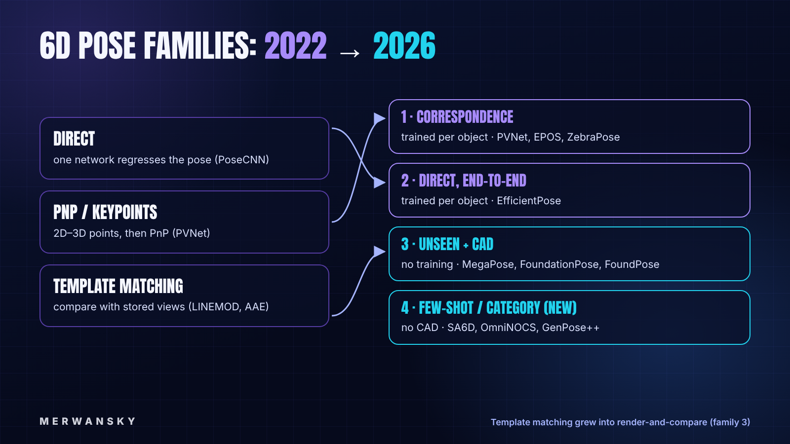
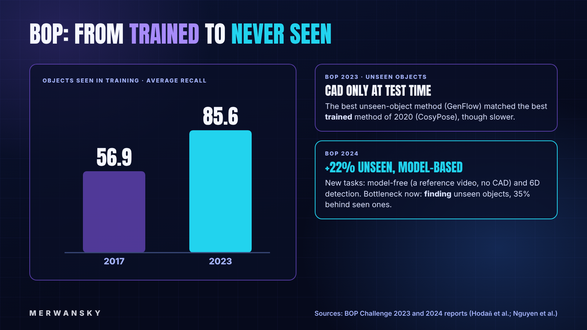
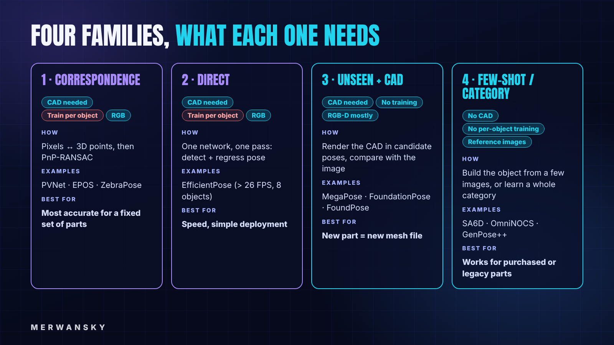
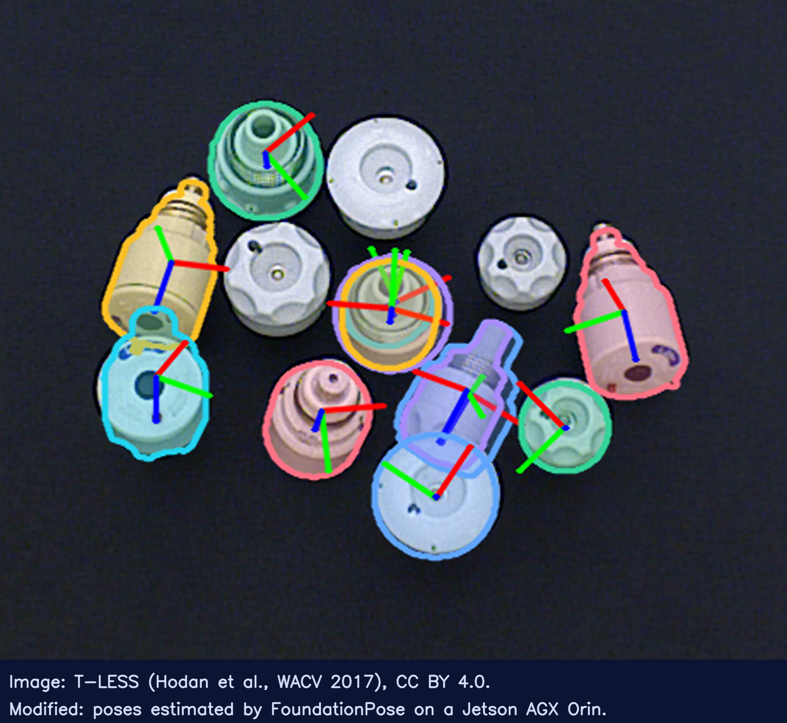
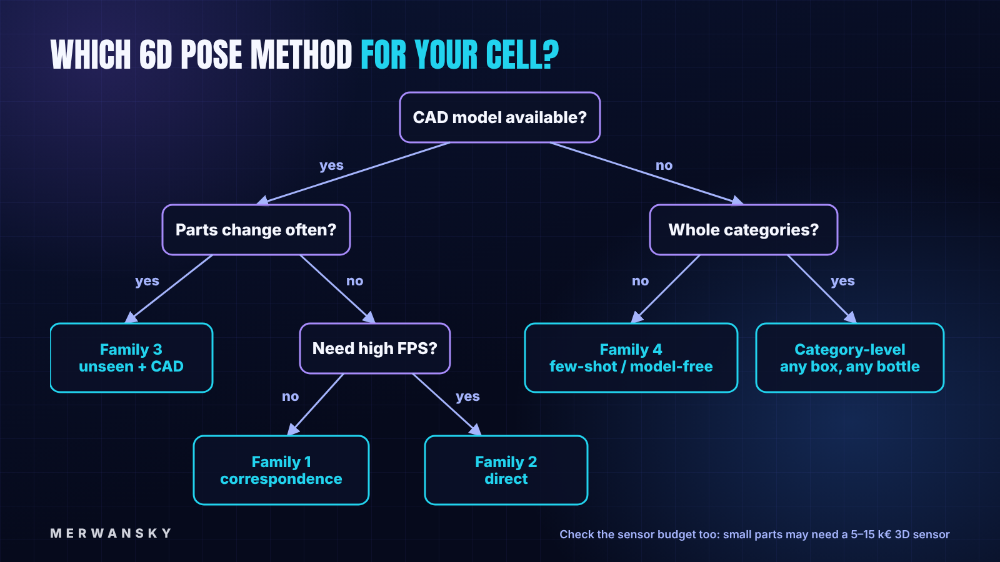

> **TLDR**: In 2022, getting the 6D pose of an industrial part meant training a network for that part, usually on a synthetic dataset you built yourself. In 2026, the strongest methods take a CAD model (or a few reference images) of an object they have never seen, and work without any training. This article recaps what 6D pose is, maps the 2022 method families onto today's four, gives a decision rule for picking one, and shows what FoundationPose does on a Jetson AGX Orin (6.6 seconds for the first pose, 116 ms per frame after that), licence included.

Hey there, in November 2022 I wrote [*What is 6D Object Pose Estimation in Computer Vision?*](https://medium.com/@just-merwan/what-is-6d-object-pose-estimation-in-computer-vision-21e8acf9e3e2) [1]. It is one of my most-read articles, so it deserves a sequel. Back then I was working on pose estimation for **assembly operations and pick-and-place**. I tried PVNet and EfficientPose on industrial objects, and the pain was always the same: training took too much work, and every new part needed its own synthetic dataset to train on, generated with tools like Unity and Blender (I wrote a whole series on that: [Part I](https://medium.com/@just-merwan/the-power-of-synthetic-image-datasets-how-blender-is-revolutionizing-ai-training-27fbccff065a) [16] and [Part V, BlenderProc](https://medium.com/@just-merwan/the-power-of-synthetic-image-datasets-blenderproc-5e3487a7b178) [17]).

In practice, onboarding one new part took us **up to two days**: get the CAD file, generate synthetic data with variations (scene, lighting, and so on), then train, then test. And even then, inference sometimes broke: the network missed the object, or got its pose wrong, in situations that never appeared in the synthetic training data.

Four years later, the question has changed from "how do I train a network for this part?" to "can I just give the model the CAD file?". In this article four things are covered: first, a 30-second recap of 6D pose; second, what changed between 2022 and 2026; third, the four method families today, with PROS and CONS; and fourth, a test of FoundationPose on a Jetson AGX Orin, followed by a decision rule for picking a method.

## A 30-Second Recap: What is 6D Pose?

The 6D pose of an object is the rigid transformation from the object's coordinate frame to the camera's coordinate frame: a **rotation** (3 degrees of freedom) and a **translation** (3 degrees of freedom) [1]. With the pose, a robot knows where to put its gripper, and an inspection system knows which side of the part it is looking at.

The classic headache is **symmetry**: a cylinder or a bolt looks the same after some rotations, so several poses explain the same image, and a network trained to output one answer gets confused [1][3].

In 2022 I grouped the methods into three families [1]:

* **Direct**: the network outputs the pose straight from the image (PoseCNN).
* **PnP-based**: find 2D keypoints, match them to the 3D model, solve Perspective-n-Point (PVNet [2]).
* **Template matching**: compare the image with a codebook of rendered views (LINEMOD, Augmented Autoencoders).

All three had one thing in common: the model had to be trained, or at least prepared, for each specific object.



## What Changed: From "Train per Object" to "Show Me the Object"

The best place to watch the field move is the **BOP benchmark** (Benchmark for 6D Object Pose Estimation), which scores methods on the same datasets every year.

Two numbers tell the story of the old world. On objects seen during training, accuracy rose from **56.9 to 85.6 AR** (average recall) between 2017 and 2023 [12]. That is solid progress, but every one of those methods still needs per-object training.

The new world started in **BOP 2023**, which added tasks on **unseen objects**: the method gets only the CAD model at test time. The best unseen-object method that year, GenFlow, matched the accuracy of the best seen-object method of 2020, CosyPose, although it was slower [12]. In other words, a model that had never seen the object did as well as a trained specialist from three years earlier.

**BOP 2024** pushed further [13]:

* **Model-free** tasks: no CAD model, only a reference video of the object.
* **6D detection**: find all instances of an object, not just estimate one pose.
* The best unseen, model-based method improved by **22%** over 2023.
* The new bottleneck is **detection**: finding unseen objects in the image still lags 35% behind seen objects.

So the pose itself is getting close to solved for objects you have a CAD model of; finding them in a cluttered bin is where the remaining work is.



## The Four Method Families in 2026

### Family 1: Correspondence Methods, Trained per Object

**How it works:** a network predicts correspondences between image pixels and points on the 3D model; PnP-RANSAC then turns them into a pose. This is the direct descendant of the 2022 PnP family.

* **PVNet** [2]: every pixel votes for the position of a few keypoints, which makes it robust to occlusion.
* **EPOS** [3]: predicts which surface fragment each pixel belongs to, which handles symmetric objects by design.
* **ZebraPose** [4]: encodes the surface with coarse-to-fine binary codes, so the network learns a hierarchy instead of exact coordinates.

**PROS:** the most accurate option when your set of objects is fixed and known.
**CONS:** training and training data for every object. That is exactly the pain from my 2022 projects.

### Family 2: Direct, End-to-End

**How it works:** one network detects the objects and regresses their 6D pose in a single forward pass.

* **EfficientPose** [5]: runs at more than 27 FPS for a single object and stays above 26 FPS with 8 objects in the scene.

**PROS:** speed and a simple deployment, one network, one pass.
**CONS:** still trained per object, and it was designed for speed first: compare its accuracy on your own parts with a Family 1 method before you commit.

### Family 3: Unseen Objects with a CAD Model

**How it works:** this is what 2022's template matching grew into. Instead of a fixed codebook, the method renders the CAD model in candidate poses and compares the renders with the real image ("render and compare"), or matches features from a large pretrained vision model.

* **MegaPose** [6]: render and compare, needs only the CAD model and a region of interest.
* **FoundationPose** [7][8]: one model for both pose estimation and tracking; works from a CAD model or a few reference images, with no fine-tuning; #1 on the BOP leaderboard for model-based unseen objects in March 2024 [8].
* **FoundPose** [9]: RGB only and training-free, using DINOv2 features.

**PROS:** a new part means a new mesh file, not a new training run. For a factory with changing product variants, this changes the economics.
**CONS:** the first detection is GPU-heavy, and most methods expect a depth image (RGB-D) [7][14].

### Family 4: Few-Shot, Model-Free and Category-Level

**How it works:** no CAD model at all. Either the object model is built on the fly from a few images, or the network learns a whole category ("any mug") instead of one instance ("this mug").

* **SA6D** [10]: builds the object representation from a few reference images, even cluttered ones.
* **FoundationPose model-free mode** [7]: reference images instead of a mesh.
* **OmniNOCS / NOCSformer** [11]: category-level, with 20× more object classes than earlier NOCS datasets.
* **Omni6DPose + GenPose++** [15]: 332K real images across 149 categories.

**PROS:** works without CAD, which matters for purchased parts or legacy products.
**CONS:** lower accuracy and less mature tooling than Families 1 and 3.



## Our Test: FoundationPose on a Jetson AGX Orin

Benchmarks on a desktop GPU are one thing; a robot cell usually has an embedded computer. So we ran FoundationPose in a **Docker container** on a Jetson AGX Orin 64 GB, the same board that runs my content studio.

### What FoundationPose needs

Per object: a CAD mesh (or a few reference images). Per frame: an RGB image, a depth image, the camera intrinsics, and a 2D mask or detection of the object for the first frame [7][14]. Under the hood it has three parts: a **pose refinement network** that improves a set of coarse pose guesses, a **pose selection network** that scores them and keeps the best, and, only for the model-free mode, a neural object field that stands in for the missing CAD model [18]. After the first frame, it switches to **tracking**, which is much cheaper than registering from scratch [7].

NVIDIA quotes about 7 GB of peak GPU memory for the FP32 pipeline in Isaac ROS and recommends at least 8 GB [14].

### Setup

NVIDIA's own ROS 2 package, `isaac_ros_foundationpose`, arrived with Isaac ROS 3.0, which requires JetPack 6 [19]. Our Jetson runs JetPack 5.1.2, and reflashing a board that runs other services was not an option. So we used the research code from NVlabs [8] on top of NVIDIA's PyTorch container for JetPack 5.

Three dependencies needed work. **nvdiffrast**, NVIDIA's renderer, only installs with a newer setuptools than the one in the image. **pytorch3d** has no ready-made package for the Jetson's ARM CPU, so it is compiled from source. And **Warp**, which FoundationPose uses for two depth filters, would not run on JetPack 5's CUDA 11.4, so we rewrote those two filters in plain PyTorch [23]. The core of the recipe:

```dockerfile
# NVIDIA's PyTorch container for JetPack 5: Ubuntu 20.04, Python 3.8, torch 2.0, CUDA 11.4
FROM nvcr.io/nvidia/l4t-pytorch:r35.2.1-pth2.0-py3
# compile CUDA code for the Orin GPU only (sm_87)
ENV TORCH_CUDA_ARCH_LIST="8.7" FORCE_CUDA=1 MAX_JOBS=8

# nvdiffrast needs setuptools >= 64 to read its pyproject.toml
RUN python3 -m pip install -U pip "setuptools>=64,<70" wheel
RUN pip install --no-build-isolation "git+https://github.com/NVlabs/nvdiffrast.git@253ac4f"
# pytorch3d: no aarch64 wheel, built from source
RUN pip install iopath fvcore && \
    pip install --no-build-isolation "git+https://github.com/facebookresearch/pytorch3d.git@v0.7.4"
# warp-lang is not installed: its two depth filters are replaced by PyTorch versions (fp_filters.py)
```

The full image (with Python 3.8 versions of the other packages and BOP's evaluation toolkit) built in **13.5 minutes** on the Orin, 7 of them for pytorch3d, and weighs 13.1 GB. Two more fixes were needed to run it, both inside the container: adding the container user to the `video` group (otherwise CUDA fails to start) and preloading two system libraries that ARM Linux otherwise refuses to load late [23]. With the image built, the whole benchmark is four commands:

```bash
# on the Jetson, from the repo root
docker build -t cs-foundationpose:0.1 infra/jetson/foundationpose   # 13.5 min
bash infra/jetson/foundationpose/get_data.sh               # YCB-V, T-LESS, BOP 2023 detections, weights
bash infra/jetson/foundationpose/run.sh bop ycbv cnos 4    # pose for every 4th BOP test image, CNOS masks
bash infra/jetson/foundationpose/run.sh eval ycbv cnos 4   # official BOP scores (+ ADD-S AUC on YCB-V)
```

The full [`Dockerfile`](https://gist.github.com/Merwanski/8495999078f07d7ae8057968c1c4e0b3#file-dockerfile), [`run.sh`](https://gist.github.com/Merwanski/8495999078f07d7ae8057968c1c4e0b3#file-run-sh) and the benchmark scripts are in this gist: https://gist.github.com/Merwanski/8495999078f07d7ae8057968c1c4e0b3 [23].

### Accuracy on public benchmarks

We measured on two datasets from the BOP benchmark [20], with BOP's official evaluation toolkit [21]; scripts and logs are in [23]:

* **YCB-V** (household objects), to compare with the numbers in the FoundationPose paper.
* **T-LESS** (30 texture-less industrial parts), because shiny, featureless parts are the factory reality.

The metric is BOP's **AR**, the mean of three recall scores (AR_VSD, AR_MSSD, AR_MSPD) [12]; on YCB-V we also report ADD-S AUC, as the paper does.

FoundationPose does not find objects by itself: it needs a 2D mask of the object in the first frame. We used the free default masks that BOP provides for this task, made by **CNOS**, a training-free segmenter for unseen objects [25]. To keep the run under a night, we took every 4th test image (YCB-V: 225 images, 1,028 objects; T-LESS: 250 images, 1,602 objects), and an object with no mask counts as a miss [23].

| Dataset | AR | AR_VSD | AR_MSSD | AR_MSPD | ADD-S AUC | For comparison |
| --- | --- | --- | --- | --- | --- | --- |
| **YCB-V**, CNOS masks | **85.3** | 83.1 | 88.9 | 84.0 | **90.7** (ADD 79.9) | Paper: 88.0 AR [7] · BOP leaderboard: 88.9 AR [24] |
| **T-LESS**, CNOS masks | **49.6** | 46.9 | 49.7 | 52.2 | — | Paper: 83.0 AR [7] · BOP leaderboard: 64.6 AR [24] |
| T-LESS, *ground-truth masks* (every 20th image, 332 objects) | **78.8** | 72.9 | 79.4 | 84.1 | — | Same 50 images with CNOS masks: 51.0 AR |

Three things to read from this table:

* **On YCB-V we land 3 points below the published numbers.** That is about what to expect: the paper's 88.0 uses Mask R-CNN detections [7] and the leaderboard entry uses SAM6D masks on an A100 [24], and the released weights were trained without the paper's diffusion-augmented data, for which NVIDIA warns that "slight performance degradation is expected" [8]. The paper's own YCB-Video ADD-S number, 97.4, is for the model-free mode [7], so it is not a like-for-like comparison with our 90.7.
* **On T-LESS, the masks cost us most of the points.** CNOS found no mask at all for 18% of the T-LESS objects (292 of 1,602), against 3% on YCB-V (27 of 1,028) [23]. With perfect masks on the same 50 images, AR jumps from 51.0 to 78.8, close to the paper's 83.0.
* **That is the BOP 2024 conclusion, reproduced on a Jetson:** for unseen objects, the pose is close to solved; finding the texture-less part in a cluttered scene is the bottleneck [13]. In a real cell, test the detector on your parts as carefully as the pose model.



*T-LESS test scene 9, image 0, with our estimated poses drawn on it: coloured outline = the CAD model rendered at our pose, red/green/blue = its x/y/z axes. The white parts without an outline got no estimate (no CNOS mask, or a mask score under 0.3), and the centre part received three overlapping estimates for different objects: the misses the scores above count. Image: T-LESS (Hodaň et al., WACV 2017), CC BY 4.0 [20], modified by the author (poses drawn) [23].*

### Speed and memory

To separate the two phases, we timed FoundationPose the way its demo uses it: `register()` once on the first frame, with the CAD model and a mask, then `track_one()` on every following frame of a 737-frame RGB-D video (640×480), with the GPU synchronised around each call [23]:

```python
est.register(K=K, rgb=rgb0, depth=d0, ob_mask=mask, iteration=5)   # first frame: 252 pose guesses, refined and scored
for rgb, d in frames[1:]:
    est.track_one(rgb=rgb, depth=d, K=K, iteration=2)              # next frames: refine last pose, no mask needed
```

Full script: [`track_timing.py`](https://gist.github.com/Merwanski/8495999078f07d7ae8057968c1c4e0b3#file-track_timing-py) [23].

| On the Jetson AGX Orin 64 GB (MAXN, PyTorch, no TensorRT) | Time | Paper, RTX 3090 [7] |
| --- | --- | --- |
| First detection (`register`), per object | **6.6 s** (median 6,638 ms over 1,310 T-LESS objects; 6,446 ms over 1,001 YCB-V objects) | about 1.3 s |
| Tracking (`track_one`), per frame | **116 ms**, i.e. 8.6 frames per second | ~32 Hz |
| Peak GPU memory | **4.3–5.0 GiB** allocated (5.1–6.7 GiB reserved by PyTorch; T-LESS is the highest) | — |

So the Orin is about 5× slower than a desktop RTX 3090 for the first detection and about 4× slower for tracking, and its peak memory is in the same range as the ~7 GB NVIDIA quotes for its Isaac ROS pipeline [14] (up to 6.7 GiB reserved, on T-LESS), so NVIDIA's 8 GB minimum is a fair rule here too. NVIDIA's Isaac ROS package runs the same networks through TensorRT [18], which needs JetPack 6 [19]; we could not test that path on this board, so treat our numbers as the plain-PyTorch baseline.

For a pick-and-place cycle this means: **register once, then track**. 6.6 seconds is too slow to run before every pick on a fast line, but fine once per part when it arrives; after that, tracking at about 9 frames per second follows the part while the robot moves.

### The licence: research is free, selling needs the other package

This is where many engineers get caught. FoundationPose comes in two packages, and they have **different licences**:

* **The GitHub release** (research code + weights, what we ran): NVIDIA Source Code License. The key sentence: the work "only may be used or intended for use non-commercially" [8].
* **The Isaac ROS release**: the ROS 2 package is Apache-2.0, and the model weights on NVIDIA's NGC catalog come under NVIDIA's Deep Learning Models License, which **allows commercial use** (products you sell): it is licensed "to develop applications only for use in systems with NVIDIA GPUs" [18][22]. The catch: it needs JetPack 6 or later [19].

What that means for what you want to do:

| You want to… | GitHub release | Isaac ROS release (NGC weights) |
| --- | --- | --- |
| **Research**: a paper, a thesis, a lab prototype, an internal evaluation or benchmark | ✅ Yes, that is what it is for | ✅ Yes |
| **Publish your results** (accuracy and speed numbers, figures, like this article) | ✅ Your results are yours. If you share the code itself, keep NVIDIA's licence and notices with it | ✅ Yes |
| **A paid project**: a client pays you for a pilot, a proof of concept or a production cell | ❌ No: money is involved in the use itself. You would need a separate licence from NVIDIA | ✅ Yes, if it runs on NVIDIA GPUs (a Jetson counts) |
| **Sell a product** that contains it (a robot cell, an inspection station, software) | ❌ No | ✅ Yes, under conditions: your application must add "material additional functionality"; the model ships inside your application, never on its own; no reverse engineering or decompiling; keep NVIDIA's notices; don't imply NVIDIA endorses you [22] |
| **Change the model or the code** | Only non-commercially, with the licence attached | The ROS package (Apache-2.0): yes, with notices. The weights: use them as delivered; reverse engineering is not allowed [22] |

The short version: **learn, test and publish with the GitHub release; build and sell with the Isaac ROS release.** If a customer will ever pay for the cell, start on Isaac ROS and a current JetPack from day one, so you don't have to redo the work later.

The datasets have their own rules too: YCB-V is MIT and T-LESS is CC BY 4.0, so both can be used commercially and their images shown with credit; ITODD, another industrial set, is CC BY-NC-SA 4.0 (non-commercial) [20], which is why we left it out.

*This is a plain-language summary of the licence texts, not legal advice. For a client project or a product, have your legal team read the actual terms.*

## Which Method Should You Pick?

You might be asking "which method should I select for my cell?". Here is the rule I would use:

1- **Fixed set of parts, CAD available, time to train** → Family 1 (correspondence), or Family 2 if you need the frame rate.
2- **Parts change often, CAD available** → Family 3 (unseen objects with CAD). Onboarding a part becomes a file upload.
3- **No CAD** → Family 4: few-shot or model-free.
4- **Whole categories, not specific parts** (any box, any bottle) → category-level methods.

Two practical constraints sit on top of the rule. First, **CAD and depth are not always available**. In my projects they generally were, but it depends on the depth sensor, the application and the accuracy you need. Second, **depth costs money**: for small objects we used high-end structured-light 3D sensors such as Zivid or Photoneo, in the range of 5–15 k€. If your budget only allows an RGB camera, that pushes you towards RGB-only methods like FoundPose [9], or back to Family 1.

So which branch would I take today for the assembly and pick-and-place cells I worked on? Probably still **branch 1, the training road**. The parts were known in advance, we had their CAD files, and the setup was deterministic. And inference time mattered. **A caveat first: these numbers come from different machines, not from one side-by-side test.** EfficientPose reports more than 27 frames per second in its paper, on the authors' hardware [5]; FoundationPose needs about 1.3 s for the first pose on a desktop RTX 3090 [7], and 6.6 s on our Jetson (see the test above). Even with that caveat, a network that answers in tens of milliseconds and a first pose that takes seconds are not in the same league for a fast line. The two days of onboarding per part are a one-off cost when the part list rarely changes; the cycle time is paid on every pick.

The balance flips when the product mix changes every few weeks: then onboarding, not inference, becomes the bottleneck, and branch 2 wins. The failure mode I described at the start, a part in a situation the synthetic data never covered, is also what the unseen-object methods aim to avoid: they compare against renders of the CAD model at test time instead of relying on what the training set happened to cover [7].



## Key Take-Aways

After reading this article you should be able to answer for yourself, and why not explain to others, the following:

* What a 6D pose is (3 rotation + 3 translation degrees of freedom) and why symmetric parts make it ambiguous.
* What changed since 2022: unseen-object methods now reach the accuracy trained specialists had a few years ago, and detection is the new bottleneck (our T-LESS run, same 50 images: 51.0 AR with off-the-shelf masks, 78.8 with perfect ones).
* The four families today (correspondence, direct, unseen with CAD, few-shot / category-level), with one example method and one trade-off each.
* How to choose for your cell, including the two real-world constraints: CAD/depth availability and sensor cost.
* Why the licence of a model matters as much as its accuracy, and that FoundationPose's GitHub release and its Isaac ROS release are licensed differently.

As always to end this article, here is the "***Quote of the Article***":

> **"The first principle is that you must not fool yourself—and you are the easiest person to fool."** — Richard P. Feynman [26]

A paper's table is not your cell: the 83.0 on T-LESS became 49.6 in our run (other masks, other hardware) [7][23]. Run the model on your own parts, detector included, before you trust a number.

Cheers

Merwansky

---

*This article was drafted with AI assistance from the 2022 article, the papers and documentation listed below and the author's answers, and reviewed and completed by the author.*

## Sources

1. M. Birem, *What is 6D Object Pose Estimation in Computer Vision?*, Medium, 2022. https://medium.com/@just-merwan/what-is-6d-object-pose-estimation-in-computer-vision-21e8acf9e3e2
2. S. Peng, Y. Liu, Q. Huang, H. Bao, X. Zhou, *PVNet: Pixel-wise Voting Network for 6DoF Pose Estimation*, CVPR, 2019. https://arxiv.org/abs/1812.11788
3. T. Hodaň, D. Baráth, J. Matas, *EPOS: Estimating 6D Pose of Objects with Symmetries*, CVPR, 2020. https://arxiv.org/abs/2004.00605
4. Y. Su et al., *ZebraPose: Coarse to Fine Surface Encoding for 6DoF Object Pose Estimation*, CVPR, 2022. https://arxiv.org/abs/2203.09418
5. Y. Bukschat, M. Vetter, *EfficientPose: An efficient, accurate and scalable end-to-end 6D multi object pose estimation approach*, arXiv:2011.04307, 2020. https://arxiv.org/abs/2011.04307
6. Y. Labbé et al., *MegaPose: 6D Pose Estimation of Novel Objects via Render & Compare*, CoRL, 2022. https://arxiv.org/abs/2212.06870
7. B. Wen, W. Yang, J. Kautz, S. Birchfield, *FoundationPose: Unified 6D Pose Estimation and Tracking of Novel Objects*, CVPR, 2024. https://arxiv.org/abs/2312.08344
8. NVlabs, *FoundationPose* repository and LICENSE (NVIDIA Source Code License), GitHub. https://github.com/NVlabs/FoundationPose
9. E. P. Örnek et al., *FoundPose: Unseen Object Pose Estimation with Foundation Features*, ECCV, 2024. https://arxiv.org/abs/2311.18809
10. N. Gao, V. A. Ngo, H. Ziesche, G. Neumann, *SA6D: Self-Adaptive Few-Shot 6D Pose Estimator for Novel and Occluded Objects*, CoRL, PMLR 229, 2023. https://proceedings.mlr.press/v229/gao23a.html
11. A. Krishnan, A. Kundu, K.-K. Maninis, J. Hays, M. Brown, *OmniNOCS: A unified NOCS dataset and model for 3D lifting of 2D objects*, ECCV, 2024. https://arxiv.org/abs/2407.08711
12. T. Hodaň et al., *BOP Challenge 2023 on Detection, Segmentation and Pose Estimation of Seen and Unseen Rigid Objects*, 2024. https://arxiv.org/abs/2403.09799
13. V. N. Nguyen et al., *BOP Challenge 2024 on Model-Based and Model-Free 6D Object Pose Estimation*, arXiv:2504.02812, 2025. https://arxiv.org/abs/2504.02812
14. NVIDIA, *Isaac ROS FoundationPose* (`isaac_ros_foundationpose`) documentation. https://nvidia-isaac-ros.github.io/repositories_and_packages/isaac_ros_pose_estimation/isaac_ros_foundationpose/index.html
15. J. Zhang et al., *Omni6DPose: A Benchmark and Model for Universal 6D Object Pose Estimation and Tracking*, arXiv:2406.04316, 2024. https://arxiv.org/abs/2406.04316
16. M. Birem, *The Power of Synthetic Image Datasets: How Blender is Revolutionizing AI Training* (Part I/V), Medium, 2024. https://medium.com/@just-merwan/the-power-of-synthetic-image-datasets-how-blender-is-revolutionizing-ai-training-27fbccff065a
17. M. Birem, *The Power of Synthetic Image Datasets: BlenderProc* (Part V/V), Medium, 2024. https://medium.com/@just-merwan/the-power-of-synthetic-image-datasets-blenderproc-5e3487a7b178
18. NVIDIA, *FoundationPose* model card (`nvidia/isaac/foundationpose`), NGC catalog. https://catalog.ngc.nvidia.com/orgs/nvidia/isaac/models/foundationpose
19. NVIDIA, *Isaac ROS release notes* (FoundationPose from 3.0.0; JetPack 6.0). https://nvidia-isaac-ros.github.io/releases/index.html
20. BOP benchmark, *Datasets* (YCB-V: MIT; T-LESS: CC BY 4.0; ITODD: CC BY-NC-SA 4.0). https://bop.felk.cvut.cz/datasets/
21. T. Hodaň et al., *bop_toolkit*, GitHub (MIT). https://github.com/thodan/bop_toolkit
22. NVIDIA, *Deep Learning Models License Agreement* (TAO Toolkit 21.08 models EULA). https://developer.download.nvidia.com/licenses/tao_toolkit_21-08_models_eula.pdf
23. M. Birem, *FoundationPose on a Jetson AGX Orin (JetPack 5.1.2), benchmarked with BOP*: Dockerfile, run scripts and evaluation, GitHub Gist, run on 2026-10-17. https://gist.github.com/Merwanski/8495999078f07d7ae8057968c1c4e0b3. Full run logs, per-pose results and the PyTorch versions of the two Warp depth filters: available upon request.
24. BOP benchmark, *Leaderboard: model-based 6D localization of unseen objects, BOP 2023 core datasets* (entry "FoundationPose(NVIDIA)", 2024-08-27: SAM6D masks, A100 GPU). https://bop.felk.cvut.cz/leaderboards/pose-estimation-unseen-bop23/core-datasets/
25. V. N. Nguyen et al., *CNOS: A Strong Baseline for CAD-based Novel Object Segmentation*, ICCV Workshops, 2023. https://arxiv.org/abs/2307.11067
26. R. P. Feynman, *Cargo Cult Science*, Caltech commencement address, 1974. https://calteches.library.caltech.edu/51/2/CargoCult.htm

_Accessed 2026-10-17._
