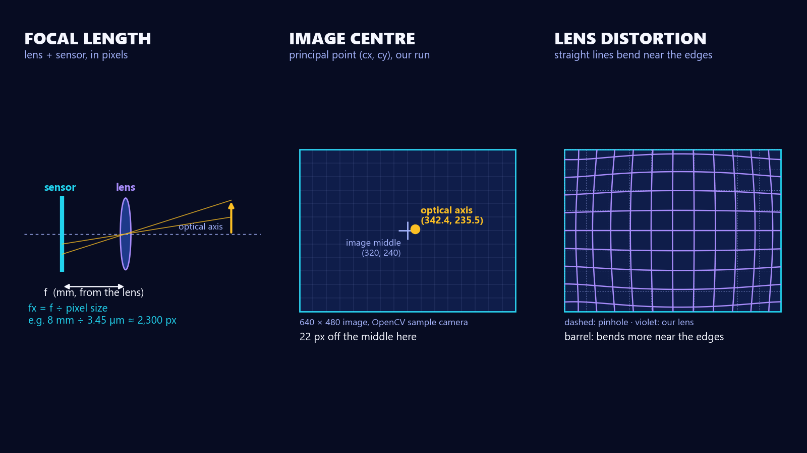
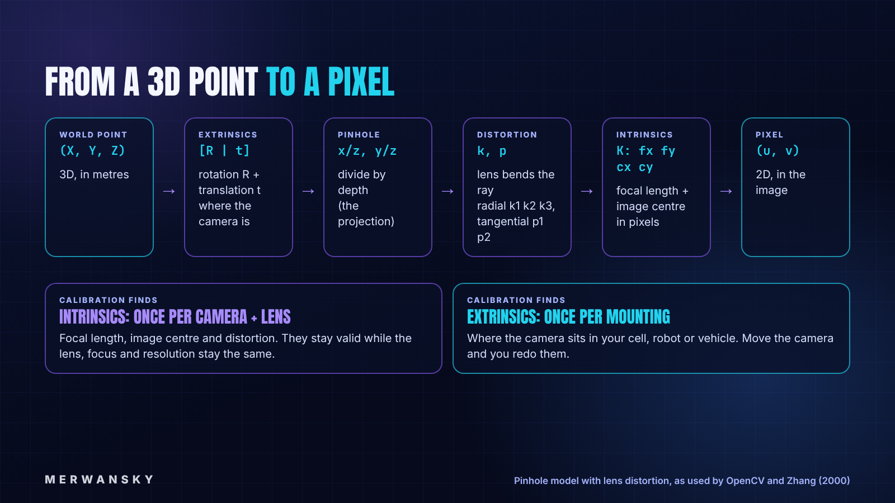
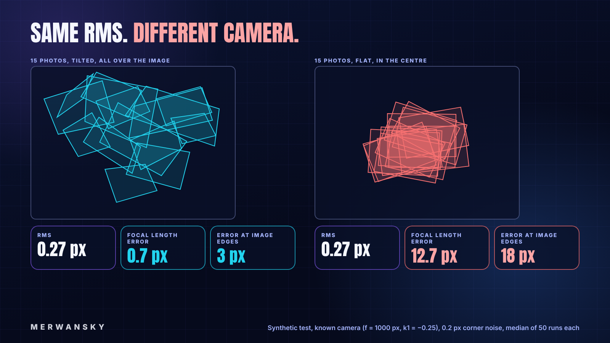
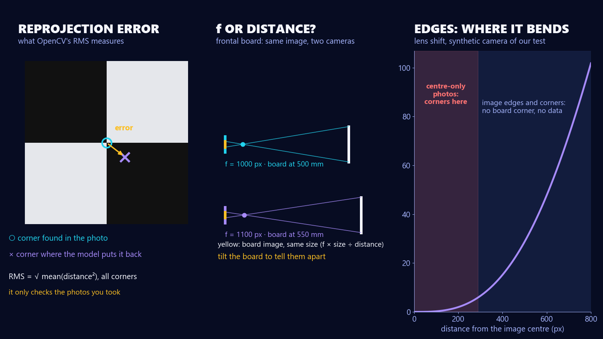
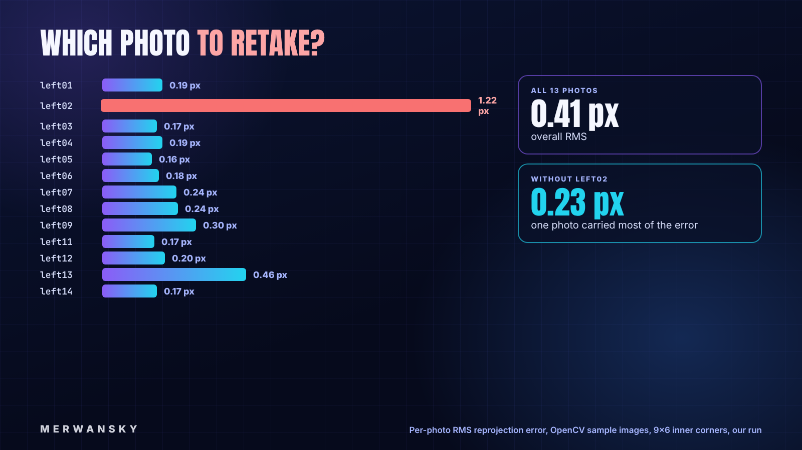
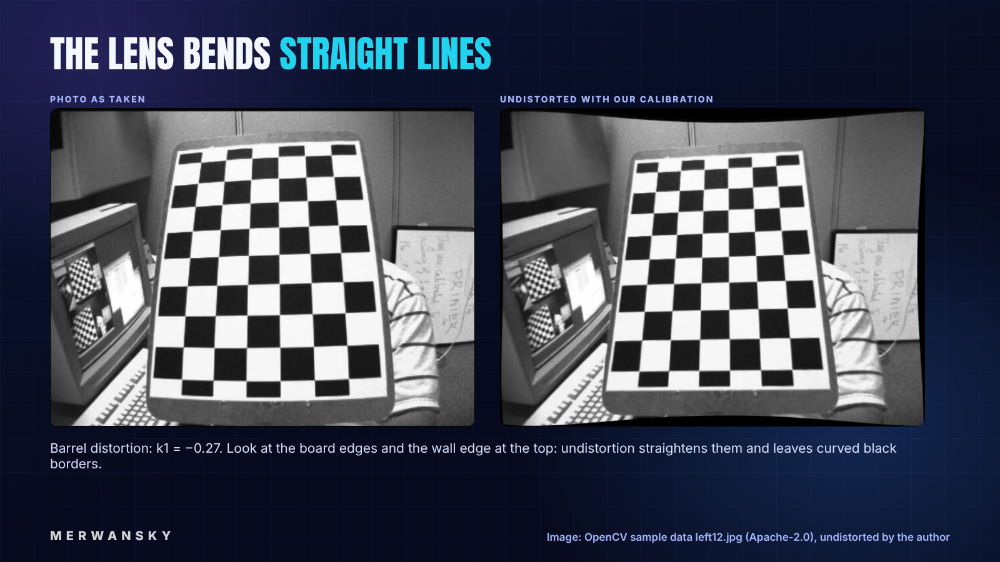
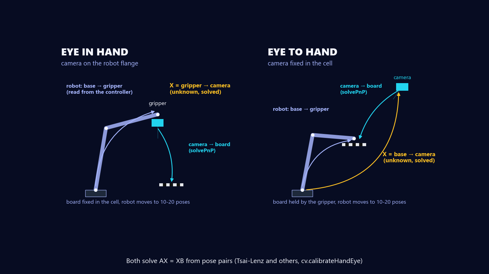
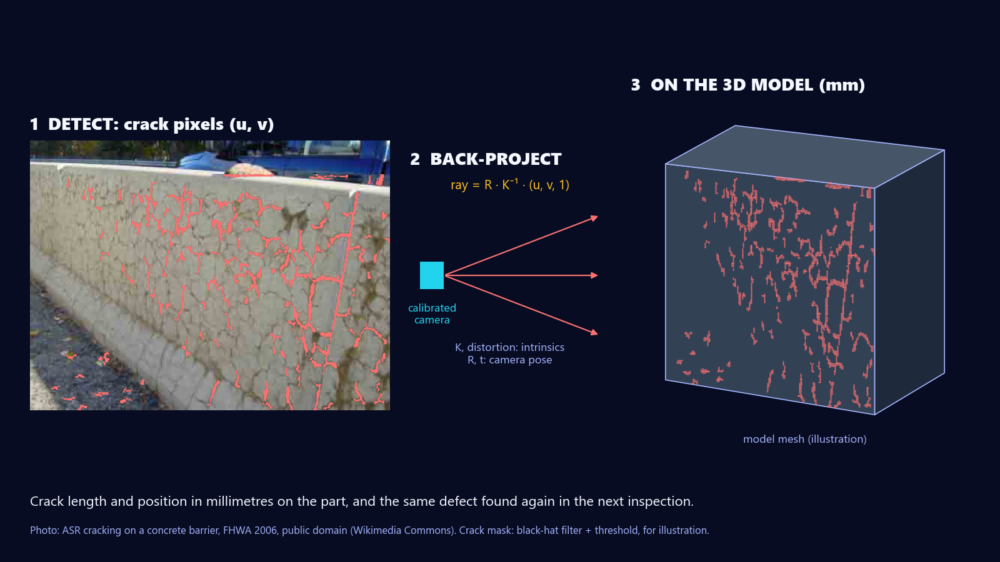
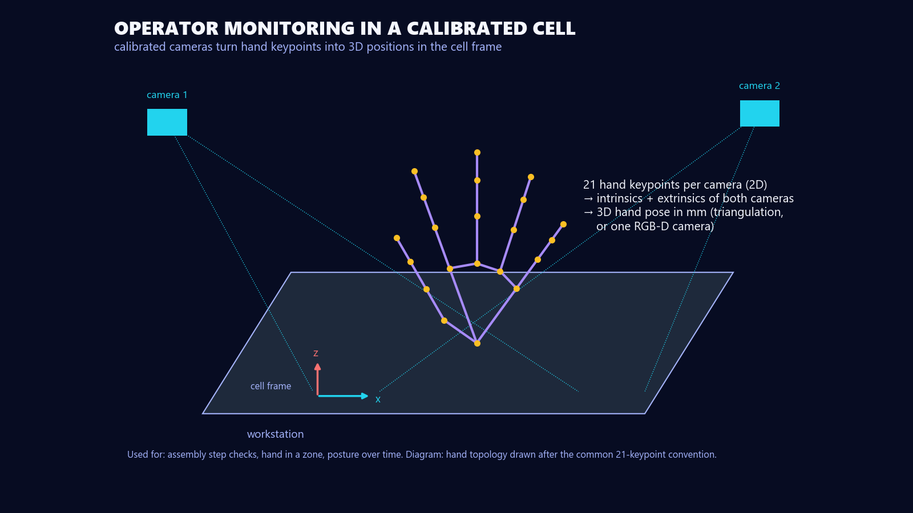

> **TLDR**: A detector tells you where an object is in pixels. Camera calibration is what turns pixels into millimetres: it finds the camera's intrinsics (focal length, image centre, lens distortion) and, for a mounted camera, its extrinsics (where it sits). With OpenCV it takes about 30 lines of Python and 15 to 20 photos of a printed board. The hard part is not the code but the photos: in our test, two photo sets gave the same 0.27 px reprojection error, yet one of them put the focal length 12.7 px off and the image edges 18 px off. Every number below comes from code we ran.

Hey there, most computer vision runs in pixels: a network finds a part, a person or a weld seam and gives you a box in image coordinates. But a robot does not grip in pixels, and a quality check does not report a gap in pixels. Somewhere between the image and the real world you need a model of the camera, and getting that model is called camera calibration.

I have calibrated more cameras than I can count: industrial cameras from IDS, Basler, FLIR and the other usual brands, and RGB-D cameras too. RGB-D cameras ship with factory intrinsics, but before a test or a deployment we still checked them. What the calibration had to make possible changed with every project: guiding a robot for pick-and-place, sorting and kitting, finding objects and estimating their 6D pose, navigation for AGVs and drones, inspection and monitoring, and 3D measurement from one or several images (photogrammetry), for example to put a defect found in a photo back onto the 3D model of the part.

In this article three things are covered: first, what calibration estimates and the camera model behind it; second, a calibration STEP by STEP with OpenCV, including how to read the result and which photo to retake; and third, the extras you meet in industry: ChArUco boards, wide-angle lenses and hand-eye calibration for a camera on a robot.

## What is camera calibration?

Camera calibration estimates the parameters of a camera model, so that you can compute where a 3D point lands in the image, and, the other way around, which ray in space a pixel looks along [1][2].

The parameters come in two groups:

* **Intrinsics** belong to the camera, meaning its lens and its sensor together. They do not depend on the scene, so you can reuse them as long as the zoom and focus stay the same [2]. There are three of them:
  * **Focal length** (fx, fy), in pixels. It mixes the lens and the sensor: the lens focal length in millimetres divided by the size of one pixel. An 8 mm lens on a sensor with 3.45 µm pixels gives fx ≈ 2,300 px. OpenCV's `calibrationMatrixValues` does the conversion back to millimetres if you give it the sensor size [2].
  * **Image centre** or principal point (cx, cy): where the optical axis hits the sensor. It is "usually close to the image center" [2], but not on it: in our run below it sits 22 px from the middle of a 640 × 480 image.
  * **Lens distortion**: how much the lens bends straight lines, more and more towards the edges of the image [2].
* **Extrinsics** describe where the camera is: a rotation and a translation from a world frame (your cell, your robot base, your board) to the camera frame [2].



The standard method today goes back to Zhengyou Zhang (2000): show the camera a flat pattern in a few orientations (at least two), compute a closed-form first guess, then refine everything with a non-linear least-squares fit that also models the lens distortion [1]. OpenCV's `calibrateCamera` is built on Zhang's method and on Bouguet's MATLAB toolbox [2].

## The camera model in four steps

### Intuition first

Follow one 3D point on its way to a pixel:

1. **Extrinsics** move the point from the world frame into the camera frame.
2. **Pinhole projection** divides by the depth: far things look smaller.
3. **Distortion** bends the ray the way a real lens does.
4. **Intrinsics** turn the result into pixels: scale by the focal length, shift by the image centre.



### Then the equations

Without distortion, the whole chain is one line [2]:

```text
s · [u, v, 1]ᵀ = K · [R | t] · [X, Y, Z, 1]ᵀ

        | fx  0  cx |
    K = |  0 fy  cy |        fx, fy: focal length in pixels; cx, cy: principal point
        |  0  0   1 |
```

Lens distortion is applied between the projection and `K`, on the normalised coordinates (x, y) with r² = x² + y². OpenCV's default model has radial terms k1, k2, k3, which grow with the distance from the centre, and tangential terms p1, p2, for a lens that is not perfectly parallel to the sensor [2]:

```text
x_d = x (1 + k1 r² + k2 r⁴ + k3 r⁶) + 2 p1 x y + p2 (r² + 2 x²)
y_d = y (1 + k1 r² + k2 r⁴ + k3 r⁶) + p1 (r² + 2 y²) + 2 p2 x y
```

A negative k1 is barrel distortion (straight lines bow outwards), a positive k1 is pincushion. Two practical consequences come straight from the model [2]:

* If you resize the image, scale fx, fy, cx and cy by the same factor. The distortion coefficients do not change.
* If the lens zoom or focus changes, the intrinsics change. Calibrate with the focus you will use.

## STEP1: print a board and measure it

Print a chessboard and glue it on something flat and rigid. Zhang's method assumes the pattern is a plane; his paper uses a laser-printed pattern on "a reasonable planar surface", such as a hard book cover [1]. For anything precise, a rigid board (aluminium, glass) keeps it a plane.

Two numbers matter:

* **Inner corners**, not squares: a board of 10 × 7 squares has 9 × 6 inner corners. That is what `findChessboardCorners` looks for.
* **Square size**, measured with a calliper on the printed board, not taken from the PDF. Printers scale. The intrinsics do not depend on it, but every translation (and so every distance you measure later) scales with it.

In practice I mostly use chessboards, in sizes from 2 × 2 cm for small close-range cameras up to 1.5 × 1.5 m for cameras that look at a whole cell. Pick the board so that it fills a good part of the image at your working distance. For a thermal camera a printed board is invisible, so we used a board with LEDs and holes that shows up in the thermal image. ChArUco boards came in when the board could not always be fully in view (more on them below), and circle grids when the project used HALCON and similar tools.

## STEP2: take the photos (this is where calibrations fail)

Take 15 to 20 sharp photos (our test below uses 15) in which the board:

* reaches **every part of the image, including the corners**,
* is **tilted** in different directions (our good set: up to 40°), not only facing the camera,
* appears at a few **distances**.

MathWorks puts it bluntly: it is "very important to have keypoints close to the edges and the corners of the image" to estimate the distortion [4].

### Our test: same error, different camera

To see why, we simulated a camera with known parameters (1280 × 960 pixels, focal length 1000 px, k1 = −0.25), let it "photograph" a 9 × 6 board in 15 poses, added 0.2 px of noise to every detected corner, and calibrated with OpenCV. We did this 50 times for two photo sets [9]:

* **Good set:** board tilted up to 40°, placed all over the image, at 35 to 70 cm.
* **Poor set:** board almost flat (under 5°), always near the centre, at about 50 cm.



| Median of 50 runs | Good set | Poor set |
| --- | --- | --- |
| RMS reprojection error (what OpenCV reports) | 0.27 px | 0.27 px |
| Focal length error | 0.7 px | **12.7 px** (worst 10%: 30 px) |
| Error at the image edges (outer 10% band) | 3 px | **18 px** (worst 10%: 62 px) |

### Why the same error hides a wrong camera

First, what the number is. For every corner in every photo, the calibration puts the board back into the image with the model it found (`projectPoints` in the script below) and measures the distance, in pixels, to the corner the detector found. The RMS reprojection error is the root of the mean of those squared distances [2][9]. So it answers one question: does the model explain **the photos you took**? It says nothing about the parts of the image those photos never covered.

The poor set fools it in two ways:

* **Frontal photos can't separate focal length from distance.** A board facing the camera at 500 mm with fx = 1,000 px gives exactly the same image as the same board at 550 mm with fx = 1,100 px: its image size is f × size ÷ distance in both cases. Zhang proves the general case: a photo of the board parallel to an earlier one "does not provide additional constraints" [1]. Tilting the board breaks the tie, because the near and far edges then shrink by different amounts.
* **Distortion lives at the edges.** The lens shift grows fast with the distance from the image centre. In the poor set, 95% of the corners sat within 288 px of the centre, while the image corners are 800 px away [9]. The model fits the centre and guesses the rest. OpenCV's documentation warns about exactly this: a failed estimation "may look deceptively good near the image center" [2].



A low RMS is necessary, not sufficient: check the coverage too, and test the result on something the calibration has not seen (a photo with the board in a corner, or a known distance).

Note also the 3 px left in the good set: our "good" boards stayed 15% away from the image border. To be accurate in the very corners, put corners in the very corners.

## STEP3: run the calibration

This script detects the board in every photo, refines the corners to sub-pixel accuracy, calibrates, and prints the error per photo. It runs as is with OpenCV 4.10 (`pip install opencv-python numpy`):

```python
"""Calibrate a camera from chessboard photos with OpenCV.
Usage: python calibrate.py "<image_glob>" <cols> <rows> <square_mm> [out.npz]
  cols, rows = number of INNER corners (a 10x7-square board has 9x6)
"""
import glob, os, sys
import numpy as np
import cv2 as cv

pattern_glob, cols, rows, square = sys.argv[1], int(sys.argv[2]), int(sys.argv[3]), float(sys.argv[4])
out = sys.argv[5] if len(sys.argv) > 5 else "calib.npz"

# 3D corner positions on the board (Z = 0 plane), in millimetres
board = np.zeros((rows * cols, 3), np.float32)
board[:, :2] = np.mgrid[0:cols, 0:rows].T.reshape(-1, 2) * square

obj_pts, img_pts, names, size = [], [], [], None
criteria = (cv.TERM_CRITERIA_EPS + cv.TERM_CRITERIA_MAX_ITER, 30, 0.001)
for f in sorted(glob.glob(pattern_glob)):
    gray = cv.imread(f, cv.IMREAD_GRAYSCALE)
    size = gray.shape[::-1]
    found, corners = cv.findChessboardCorners(gray, (cols, rows), None)
    if not found:
        print(f"{f}: board not found, skipped")
        continue
    corners = cv.cornerSubPix(gray, corners, (11, 11), (-1, -1), criteria)  # refine to sub-pixel
    obj_pts.append(board)
    img_pts.append(corners)
    names.append(f)

rms, K, dist, rvecs, tvecs = cv.calibrateCamera(obj_pts, img_pts, size, None, None)
print(f"views used: {len(names)}  image size: {size}")
print(f"RMS reprojection error: {rms:.3f} px")
print("camera matrix K:\n", np.array2string(K, precision=1, suppress_small=True))
print("distortion (k1 k2 p1 p2 k3):", np.array2string(dist.ravel(), precision=4))

# per-view error: which photo to retake?
for f, o, i, r, t in zip(names, obj_pts, img_pts, rvecs, tvecs):
    proj, _ = cv.projectPoints(o, r, t, K, dist)
    err = np.sqrt(np.mean(np.sum((proj - i) ** 2, axis=2)))
    print(f"  {os.path.basename(f)}: {err:.3f} px")

np.savez(out, K=K, dist=dist, size=size, rms=rms)
print("saved", out)
```

What the less obvious lines do:

```text
findChessboardCorners(gray, (cols, rows))   # finds the inner corners, row by row; fails if part of the board is hidden
cornerSubPix(..., (11, 11), ...)            # refines each corner in an 11x11 window to a fraction of a pixel
calibrateCamera(obj, img, size, None, None) # Zhang's method + non-linear refinement; returns RMS, K, distortion, one pose per photo
projectPoints(o, r, t, K, dist)             # re-projects the board with the result: the per-photo error is the gap to the detected corners
```

We ran it on the 13 chessboard photos that ship with OpenCV (`left01.jpg` … `left14.jpg`, 640 × 480, 9 × 6 inner corners) [3]. Their real square size is not documented, so we used 25 mm, which only scales the translations [9]:

```text
$ python calibrate.py "data/left*.jpg" 9 6 25
views used: 13  image size: (640, 480)
RMS reprojection error: 0.409 px
camera matrix K:
 [[536.1   0.  342.4]
 [  0.  536.  235.5]
 [  0.    0.    1. ]]
distortion (k1 k2 p1 p2 k3): [-0.2651 -0.0467  0.0018 -0.0003  0.2523]
  left01.jpg: 0.193 px
  left02.jpg: 1.220 px
  left03.jpg: 0.175 px
  ...
  left13.jpg: 0.462 px
  left14.jpg: 0.175 px
saved calib.npz
```

## STEP4: read the result and retake the bad photo

Three checks, in this order:

1. **The overall RMS.** There is no universal threshold: MathWorks' own example ends at 0.19 px and says the acceptable value "depends on the precision requirements of your particular application" [4]. In MathWorks' example and in both of our runs below, a sharp camera and a decent board landed well under 1 px [4][9].
2. **The error per photo.** One photo far above the others can be a blurred image, a board that bent, or a detection gone wrong. MathWorks recommends excluding the images with the highest error and recalibrating [4].
3. **The coverage.** Plot where the board was in each photo. If the corners of the image are empty, take more photos there (STEP2).

In our run, `left02.jpg` has 1.22 px while every other photo is between 0.16 and 0.46 px. Without it, the RMS drops from 0.41 to 0.23 px, and the focal length moves from 536.1 to 534.1 px [9].



Look at the distortion coefficients too: k2 went from −0.047 to 0.005 and k3 from 0.25 to 0.18 when we removed a single photo. The higher-order terms trade off against each other, so do not read them one by one. OpenCV lets you fix k3 to zero (`flags=cv.CALIB_FIX_K3`) [2]; for a lens with mild distortion, try it and compare the per-photo errors.

## STEP5: undistort an image

With `K` and the distortion coefficients you can straighten any image from that camera:

```python
import numpy as np, cv2 as cv
c = np.load("calib.npz"); K, dist = c["K"], c["dist"]
img = cv.imread("data/left12.jpg")
h, w = img.shape[:2]
newK, roi = cv.getOptimalNewCameraMatrix(K, dist, (w, h), 1, (w, h))  # alpha=1: keep every pixel
und = cv.undistort(img, K, dist, None, newK)
cv.imwrite("left12_undistorted.png", und)
```

`alpha` in `getOptimalNewCameraMatrix` chooses between keeping every source pixel (`1`, with black curved borders) and cropping to valid pixels only (`0`). For a video stream, compute the maps once with `cv.initUndistortRectifyMap` and call `cv.remap` per frame instead of `undistort`.



## STEP6: the extrinsics, where is the camera?

Once the intrinsics are known, a single photo of the board, lying at a known place in your cell, gives the camera pose with `solvePnP`:

```python
ok, rvec, tvec = cv.solvePnP(board_mm, corners_px, K, dist)   # board frame -> camera frame
R, _ = cv.Rodrigues(rvec)
cam_in_board = -R.T @ tvec                                     # camera position in the board frame (mm)
```

From then on, a pixel plus one known constraint (the part lies on the conveyor plane, or a second camera sees it) gives a position in millimetres. One camera alone only gives a ray: the depth along it stays unknown.

## Beyond the chessboard: what you meet in industry

### ChArUco boards: when the board is partly hidden

A plain chessboard must be fully visible, or detection fails. A **ChArUco** board puts ArUco markers in the white squares, so every corner has an ID and a partial view still counts [5]. In our test we cut off the right edge of a 7 × 5 ChArUco board: the ChArUco detector found 19 of the 24 corners, the chessboard detector found nothing on the same image [9]. With OpenCV 4.10:

```python
dictionary = cv.aruco.getPredefinedDictionary(cv.aruco.DICT_5X5_100)
board = cv.aruco.CharucoBoard((7, 5), 0.04, 0.03, dictionary)   # 7x5 squares, 40 mm squares, 30 mm markers
detector = cv.aruco.CharucoDetector(board)
ch_corners, ch_ids, _, _ = detector.detectBoard(gray)
obj, img = board.matchImagePoints(ch_corners, ch_ids)          # 3D/2D pairs, ready for calibrateCamera
```

That matters on a robot or in a crowded cell, where you cannot always keep the whole board in view, and it lets you push the board into the image corners (STEP2) without losing the photo.

### Wide-angle and fisheye lenses

For fisheye lenses, OpenCV has a separate `cv.fisheye` module with its own projection model and calibration function [2]. Use it instead of adding more k terms to the standard model.

### Hand-eye calibration: a camera on a robot

A camera in a robot cell is mounted in one of two ways [10]:

* **Eye in hand:** the camera sits on the robot flange and moves with it. You need the transform from the gripper (the tool point) to the camera.
* **Eye to hand:** the camera is fixed in the cell and watches the robot. You need the transform from the robot base to the camera.

Calibrating the camera alone is not enough in either case: without that transform, a part seen by the camera can't be reached by the gripper. Finding it is hand-eye calibration, a problem solved by Tsai and Lenz in 1989 [6], and available in OpenCV as `calibrateHandEye` [2]. The robot poses come from the controller, the board poses from the camera images [10].



The recipe: move the robot to 10 or more poses around a fixed board, record the gripper pose from the robot controller and the board pose from `solvePnP`, then solve. We tested it on synthetic data with a known answer (12 poses, 0.05° and 0.5 mm of noise on each board pose) [9]:

```python
R_cam2grip, t_cam2grip = cv.calibrateHandEye(R_gripper2base, t_gripper2base,   # from the robot, per pose
                                             R_target2cam, t_target2cam,       # from solvePnP, per pose
                                             method=cv.CALIB_HAND_EYE_TSAI)
```

```text
hand-eye TSAI      : rotation error 0.183 deg, translation error 0.95 mm
hand-eye PARK      : rotation error 0.172 deg, translation error 0.97 mm
hand-eye DANIILIDIS: rotation error 0.176 deg, translation error 1.10 mm
```

All three methods recover the camera mount to about 0.2° and 1 mm here. On a real robot, the robot's own positioning error and the board detection add to that.

I have done hand-eye calibration many times, in both set-ups, with RGB cameras and with RGB-D cameras such as Zivid. Some vendors ship their own tool with an interface to the robot: it collects the robot poses and solves the equations for you. Most of the time, though, it was OpenCV and Python, written from the math above. A few habits from those projects:

* **10 to 20 poses.** More than the minimum, so that you also get a mean and a standard deviation, not just one answer.
* **Check it, don't trust it.** Send the robot to a reference point, for example the centre or the corners of an ArUco marker in the cell, and look at how far off the tool tip lands. If it is off, recalibrate.
* **Redo it when the set-up changes:** the system moves to a new location, the camera is moved, or the tool centre point (TCP) changes.

### Several cameras, or a camera and an IMU

For multi-camera rigs, and for a camera plus an IMU on a drone or a mobile robot, look at **Kalibr** from ETH Zurich: it calibrates multi-camera systems, camera-to-IMU (spatial and temporal), and rolling-shutter cameras [7].

## What calibration makes possible

Everything below starts from the same two pieces: the intrinsics turn a pixel into a ray, and the extrinsics put that ray into the frame of your cell, robot or part.

* **Robot guidance:** pick-and-place, sorting and kitting. The camera finds the part, hand-eye calibration tells the robot where it is.
* **Pose estimation and navigation:** the 6D pose of an object, or of the camera itself on an AGV or a drone.
* **3D from images:** measuring from one image with a known plane, or from several images (stereo, photogrammetry).
* **Inspection and monitoring:** a defect found in a 2D image becomes a position on the part.

Take a crack. A detector marks the crack pixels in the photo. With the intrinsics and the camera pose, each pixel becomes a ray, and the ray hits the 3D model of the part. The crack now has a length in millimetres and a place on the model, so the next inspection can check whether it grew.



The same chain works for people. In operator assembly monitoring, a hand-keypoint detector gives 2D points per camera; two calibrated cameras (or one RGB-D camera) turn them into a 3D hand pose in the cell frame, so you can check which assembly step is done, whether a hand is in a zone, or how the posture changes over time.



## Pitfalls that break a calibration

* **Autofocus or zoom on.** The intrinsics are only valid for one focus and zoom setting [2]. Fix them before calibrating.
* **Resolution changed.** Calibrated at 1280 × 960, running at 640 × 480? Scale fx, fy, cx, cy by 0.5 [2].
* **Board not flat or square size wrong.** The model assumes a plane with known geometry; a bent board or an unmeasured square size shows up as error or as a wrong scale.
* **Only frontal, central photos.** A low RMS that hides a wrong camera (our test above).
* **Blur.** Motion blur moves the corners. Use a short exposure and hold still.

Three of these I have seen more than any other in projects. Photos that all look alike: same position, board in the middle, no edges, no tilt, no change in distance. Someone touching the lens during or after the photos to fix the focus. And camera settings changed between calibration and use, the resolution most of all.

How do you notice? Look, don't just read the number:

* **While you take the photos,** watch the live image with the detected corners drawn on it (`cv.drawChessboardCorners`). You see at once whether the board reaches the corners, whether it is tilted enough, and whether a photo is blurred.
* **After the calibration,** plot where the board was in every photo (coverage), print the error per photo (STEP4), and undistort an image with straight lines in it: they should come out straight up to the borders.
* **Before you use it,** test on something the calibration has not seen: a new photo with the board in a corner, a known distance, or, with a robot, the reference-point check from the hand-eye section.

## Key Take-Aways

After reading this article you should be able to answer for yourself, and why not explain to others, the following:

* What calibration estimates: intrinsics (focal length, image centre, distortion) once per camera and lens, extrinsics once per mounting.
* How a 3D point becomes a pixel: extrinsics, projection, distortion, intrinsics.
* How to calibrate with OpenCV in about 30 lines, and how to use the per-photo error to find the photo to retake.
* Why a low reprojection error is not enough: in our test, the same 0.27 px hid a 12.7 px focal length error when the photos only covered the centre.
* When to go further: ChArUco for partial views, `cv.fisheye` for wide lenses, hand-eye calibration for a camera on a robot (and a reference-point check to know when to redo it), Kalibr for camera rigs and IMUs.

As always to end this article, here is the "***Quote of the Article***":

> **"The purpose of computing is insight, not numbers."** — Richard Hamming [8]

A reprojection error is a number. The insight is in the coverage plot and the per-photo errors: look at them before you trust the calibration.

Cheers

Merwansky

---

*This article was drafted with AI assistance from the papers and documentation listed below, with the code run and the figures generated for this article, and reviewed and completed by the author.*

## Sources

1. Z. Zhang, *A Flexible New Technique for Camera Calibration*, IEEE Transactions on Pattern Analysis and Machine Intelligence, 22(11), 1330–1334, 2000. https://www.microsoft.com/en-us/research/publication/a-flexible-new-technique-for-camera-calibration/
2. OpenCV, *Camera Calibration and 3D Reconstruction* (calib3d module: pinhole and distortion model, `calibrateCamera`, `solvePnP`, `calibrateHandEye`, fisheye). https://docs.opencv.org/4.x/d9/d0c/group__calib3d.html
3. OpenCV, sample chessboard images `samples/data/left01.jpg` … `left14.jpg`, Apache-2.0. https://github.com/opencv/opencv/tree/4.x/samples/data
4. MathWorks, *Evaluating the Accuracy of Single Camera Calibration*, Computer Vision Toolbox documentation. https://www.mathworks.com/help/vision/ug/evaluating-the-accuracy-of-single-camera-calibration.html
5. OpenCV, *Calibration with ArUco and ChArUco* (tutorial). https://docs.opencv.org/4.x/da/d13/tutorial_aruco_calibration.html
6. R. Y. Tsai, R. K. Lenz, *A New Technique for Fully Autonomous and Efficient 3D Robotics Hand/Eye Calibration*, IEEE Transactions on Robotics and Automation, 5(3), 345–358, 1989. https://researchr.org/publication/TsaiL89
7. ETH Zurich Autonomous Systems Lab, *Kalibr* (multi-camera, camera-IMU, rolling-shutter calibration), GitHub, BSD licence. https://github.com/ethz-asl/kalibr
8. R. W. Hamming, *Numerical Methods for Scientists and Engineers*, McGraw-Hill, 1962, Preface. https://en.wikiquote.org/wiki/Richard_Hamming
9. M. Birem, calibration runs for this article (OpenCV 4.10.0, Python): `calibrate.py` on the OpenCV sample images (re-run with 4.13.0: same numbers), synthetic coverage test (50 × 2 calibrations), ChArUco partial-view and hand-eye tests, 2026-10-31. Scripts and logs: available upon request.
10. M. Ingvaldsen, *The benefits of 3D hand-eye calibration*, Zivid blog, 2019-11-13 (eye-in-hand vs eye-to-hand). https://blog.zivid.com/importance-of-3d-hand-eye-calibration
11. Federal Highway Administration, *ASR cracks, concrete step barrier* (2006), public domain, via Wikimedia Commons (photo used in the crack figure). https://commons.wikimedia.org/wiki/File:ASR_cracks_concrete_step_barrier_FHWA_2006.jpg

_Accessed 2026-10-31 (sources 1, 2, 10, 11 re-opened 2026-11-01)._
