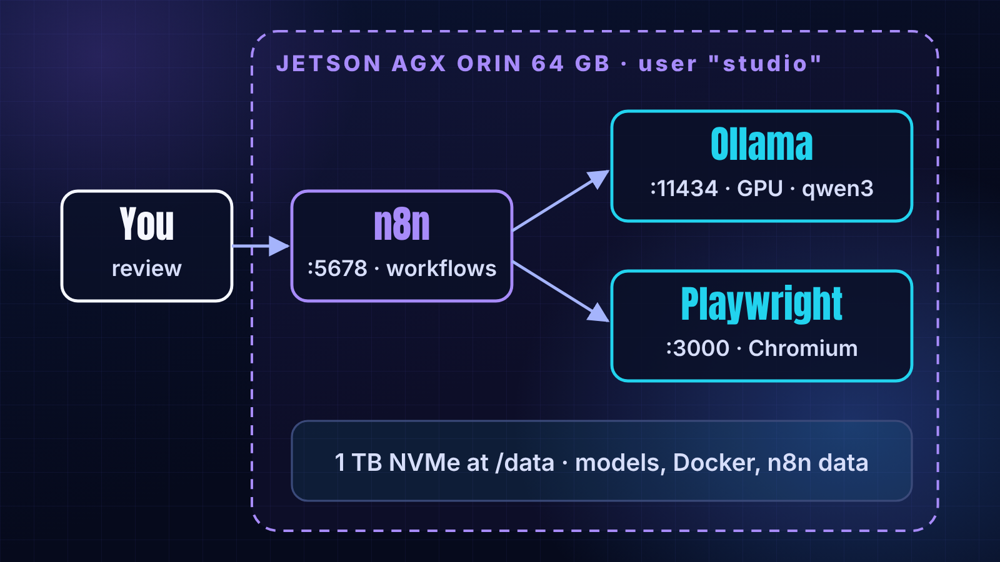
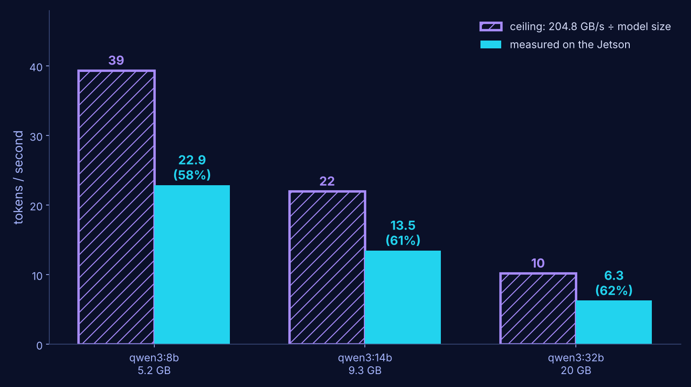

> **TLDR**: I turned a Jetson AGX Orin 64 GB into the always-on hub of my writing workflow: n8n for automation, a headless Chromium (Playwright) for the web, and Ollama running three Qwen3 models on the GPU. From the first SSH login to a healthy stack with a benchmark took about 40 minutes. Five things broke; none needed a reboot. The 32B model writes the best social captions at 6.3 tokens/s, which is too slow for chat and perfectly fine for a background job.

Hey there, this article is a bit different. Instead of explaining an algorithm, I'm showing you a system I am building in public: a small "content studio" that turns ideas into articles and social posts, where AI does the scaffolding and I keep the thinking and the final say.

Three things are covered: first, why a Jetson and not a cloud server; second, the stack and the exact compose file; and third, what broke, how it was fixed, and what the benchmark says about running LLMs on an edge device.

I started it to build my own second brain: a structure for what I know, a habit of learning, and a way to share what I learn and come across, including topics where I am not an expert and want to explore.

## Why a Jetson?

My constraints were simple: **€0 recurring cost**, everything **always on**, and nothing private leaving the house. That rules out paid APIs for routine jobs and a laptop that sleeps.

The Jetson AGX Orin 64 GB was already on my desk. On paper it is an embedded robotics computer, but three properties make it a good home server for AI automation:

* **64 GB of unified memory.** CPU and GPU share the same 256-bit LPDDR5 memory, with 204.8 GB/s of bandwidth [1]. A 20 GB model fits with room to spare for everything else.
* **A real CUDA GPU** at a fraction of a desktop's power draw.
* **It is designed to run 24/7.**

Until now I used it mainly for inference in vision projects, which is my main background.

## The Architecture

Three containers, one compose file, one non-admin user:



Or, as plain text:

```
                  ┌──────────────────────── Jetson AGX Orin 64 GB ────────────────────────┐
  Windows desk    │                                                                         │
  (writing,  ───► │   n8n :5678  ──►  Ollama :11434 (GPU)   qwen3 8b / 14b / 32b on NVMe   │
   reviews)       │      │                                                                  │
                  │      └──────►  Playwright :3000  (headless Chromium, internal only)     │
  GitHub repo ◄───┤   everything runs as user "studio", data on the 1 TB NVMe              │
                  └─────────────────────────────────────────────────────────────────────────┘
```

* **n8n** is the automation engine. It already ran my email capture and Instagram publishing workflows; now it lives on a machine that never sleeps.
* **Playwright** runs a Chromium server inside Docker. Workflows connect to it to read web pages or take screenshots, the way the official Playwright docs describe [2].
* **Ollama** serves local models for routine text jobs: captions, summaries, tags. Quality drafting stays in Claude Code; the local model handles the high-volume, low-stakes work.

The key part of the compose file (all image tags pinned, secrets in a `.env` file):

```yaml
services:
  n8n:
    image: n8nio/n8n:2.42.6
    user: "1001:1002"                     # the non-admin "studio" user
    environment:
      HOME: /home/node                    # uid 1001 is unknown in the image -> HOME would be "/"
      N8N_USER_FOLDER: /home/node
      N8N_ENCRYPTION_KEY: ${CS_N8N_ENCRYPTION_KEY:?set it in .env}
    volumes:
      - /home/studio/n8n-data:/home/node/.n8n
    tmpfs:
      - /home/node/.cache:uid=1001,gid=1002,mode=0700

  playwright:
    image: mcr.microsoft.com/playwright:v1.64.0-noble
    command: ["npx", "-y", "playwright@1.64.0", "run-server", "--port", "3000", "--host", "0.0.0.0"]
    ipc: host                             # Chromium needs more shared memory than Docker's 64 MB
    expose: ["3000"]                      # internal only

  ollama:
    image: ollama/ollama:0.40.2
    runtime: nvidia                       # Jetson GPU via the NVIDIA container runtime
    user: "1001:1002"
    group_add: ["44", "103"]              # video + render: access to /dev/nvhost-* and /dev/nvmap
    environment:
      OLLAMA_MODELS: /models
      JETSON_JETPACK: "5"                 # no /etc/nv_tegra_release inside the container
    volumes:
      - /data/studio/ollama:/models       # NVMe, not the eMMC
```

Every non-obvious line in there is a scar from the build. Here is the story behind them.

## What Broke (and the Fix)

The whole build took about 40 minutes, with Claude Code working over SSH and me approving each step. Of those 40 minutes, my hands-on time was 3 minutes: running one admin script. Here are the five failures, in order.

### 1. The disk was full before we started

The Jetson boots from a 64 GB eMMC with **14 GB free**. Three models need about 34 GB. The 1 TB NVMe was there, but mounted under an old name with permissions that blocked the new user.

**Fix:** one sudo script that renamed the host, mounted the NVMe at `/data`, created a shared group, moved Docker's storage onto it and kept the old path as a symlink. Backups, a rollback trap and a check block at the end. I ran it once; it took 3 minutes.

Why one script and not ten commands? Mostly so the setup is easy to deploy again and to reuse on the next machine.

### 2. n8n: "EACCES: mkdir '/.n8n'"

Running containers as a non-root user is good practice, but the user (uid 1001) doesn't exist inside the n8n image. No passwd entry means no home folder, so `HOME` defaults to `/`, and n8n tries to write to the root of the filesystem.

**Fix:** set `HOME` and `N8N_USER_FOLDER` explicitly.

### 3. Ollama ran happily, on the CPU

This is the dangerous one, because nothing errors out. The log line simply said `library=cpu`. Two causes:

* Ollama detects JetPack from a host file that isn't inside the container, so `JETSON_JETPACK=5` has to be set by hand.
* The GPU device files are owned by the `video` group, and the container user wasn't in it.

**Fix:** `group_add` with the video and render group IDs. The log then reports `library=CUDA compute=8.7 name=Orin`. Because a silent CPU fallback can come back after any change, the stack now has a health check that fails if the GPU devices aren't readable, plus a script that sends a real prompt and checks the whole model sits in GPU memory.

### 4. n8n restart loop: "mkdir '/home/node/.cache'"

`/home/node` belongs to uid 1000 in the image, so our uid 1001 can't create a cache folder there. Environment variables didn't help; n8n uses that path no matter what.

**Fix:** mount a small `tmpfs` at `/home/node/.cache`, owned by our user. n8n went healthy with zero restarts.

### 5. Python 3.8 on the host

The benchmark script used the `dict | dict` merge syntax, which needs Python 3.9. JetPack 5 ships 3.8. Rewritten with `dict.update()`. (The containers carry their own runtimes, so this only affects scripts on the host.)

## Benchmark: Which Local Model Is Worth Running?

I pulled three sizes of **Qwen3** (quantised Q4_K_M) and gave each the same real task: write an Instagram caption for my last article, using my voice rules. The prompt was the full article, 4,208 tokens.

| Model | On disk | Memory in use | Cold load | **Generation speed** | Total time (cold) |
| --- | --- | --- | --- | --- | --- |
| qwen3:8b | 5.2 GB | 6.3 GB | 7.1 s | **22.9 tok/s** | 17 s |
| qwen3:14b | 9.3 GB | 10.5 GB | 8.3 s | **13.5 tok/s** | 31 s |
| qwen3:32b | 20 GB | 22.3 GB | 15.8 s | **6.3 tok/s** | 62 s |

Two things stand out.



**Speed is set by memory bandwidth.** To generate one token, the GPU has to read every weight once. With 204.8 GB/s, the theoretical ceiling is roughly bandwidth divided by model size: about 39, 22 and 10 tokens/s for the three models. The measured speeds are about 60% of that ceiling for all three. So on a Jetson, the quickest way to estimate an LLM's speed is to divide the bandwidth by the model's file size and take 60%.

**Bigger was better, but not at following rules.** All three captions stayed under 150 words and invented nothing. But:

* the **8B** was correct and thin, and invented a hashtag (`#montecarlotest`);
* the **14B** had the best hook and repeated itself, and dropped a `#`;
* the **32B** was the most accurate and complete, and used `**bold**` markdown, which Instagram shows as literal asterisks.

**My choice:** the 32B for social copy. One minute per caption doesn't matter for a background job that waits for my approval anyway, and a small lint script strips markdown and repairs hashtags before anything reaches me. The 8B handles high-volume jobs like summaries and tagging.

Would I post it? Yes, as is, once the lint script has removed the bold.

## Key Take-Aways

After reading this article you should be able to answer for yourself, and why not explain to others, the following:

* Why a Jetson AGX Orin can be a good €0, always-on hub for AI automation: unified memory, a CUDA GPU, low power.
* The three hidden costs of running Docker containers as a non-root user: no `HOME`, no supplementary groups, and image folders owned by someone else.
* How to catch Ollama silently running on the CPU, and why that check belongs in a health check.
* How to estimate local LLM speed on a Jetson: bandwidth ÷ model size, then about 60%.
* Why the right model for a background job is not the fastest one, but the one whose output you have to fix least.

The next article in this series shows the first workflow running on this stack.

As always to end this article, here is the "***Quote of the Article***":

> **"Make it work, make it right, make it fast."** — Kent Beck

Forty minutes got it working. The health checks make it right. Speed, for a background job, turned out to matter least.

Cheers

Merwansky

---

*This article was drafted with AI assistance from the author's build log and benchmark, and reviewed and completed by the author.*

## Sources

1. NVIDIA, *Jetson AGX Orin Series Technical Brief* (64 GB: 256-bit LPDDR5, 204.8 GB/s). https://nvidia.com/content/dam/en-zz/Solutions/gtcf21/jetson-orin/nvidia-jetson-agx-orin-technical-brief.pdf
2. Playwright documentation, "Docker" (remote server with `run-server`, `--ipc=host` for Chromium). https://playwright.dev/python/docs/docker
3. n8n documentation, "Docker installation". https://docs.n8n.io/deploy/host-n8n/install-options/install-with-docker/
4. Ollama, Qwen3 model library. https://ollama.com/library/qwen3
5. Author's build log and benchmark (compose file, timings, captions), `content-studio/infra/jetson/BUILD-LOG.md` and `benchmark.md`, 2026-10-10.

_Sources 1–2 accessed 2026-10-10; sources 3–4 accessed 2026-10-13._
