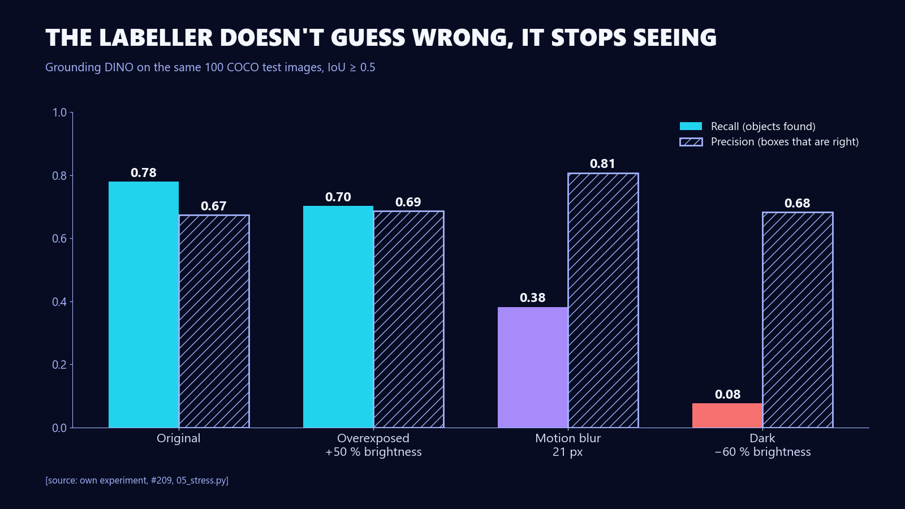
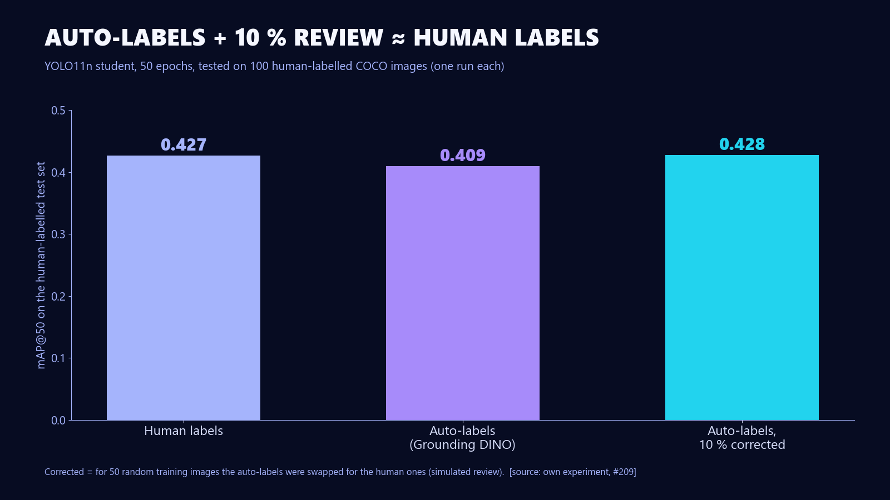

> **TLDR**: No, but the job has changed. In 2026 you can type class names and get boxes and masks from an open-vocabulary detector, a promptable segmenter or a vision-language model (VLM), and the best VLMs reach 60–77 % mAP@50 as labellers on Roboflow's benchmark [8]. Even Meta's SAM 3 data engine still keeps humans in the loop for the hard cases; AI verifiers only doubled its throughput [6]. In industry the labels that matter most (defects, reflective parts, fast motion) are exactly where auto-labelling breaks. In our own test on COCO, a YOLO11n trained on Grounding DINO's labels scored 0.409 mAP@50 against 0.427 with human labels, and correcting 10 % of the images closed the gap; but darkening the images cut the labeller's recall from 0.78 to 0.08. Use the model to draft, a human to decide, and always keep a human-labelled test set.

Hey there, if you've trained a custom detector, you know the expensive part was never the training. It was the labels: thousands of boxes, a few hundred hours, and a long discussion about whether a half-hidden part counts.

In this article three things are covered: first, why labels still decide how good your model is; second, the four ways to spend fewer human hours on them in 2026, each with its PROS and CONS; and third, an experiment on a public dataset that shows what auto-labels are worth and where they break.

## How labelling is done today, in practice

In our projects labelling is still mostly manual. The automation we use is small but helps: a tracker in CVAT propagates boxes from frame to frame for object detection, and CVAT's built-in segmentation helper (SAM) turns a few clicks into a mask. For some projects we outsource the labelling, especially when there is a large amount of data, or when spotting a defect needs an expert decision that a general annotator can't make.

So "manual" no longer means drawing every box by hand. It means a person is still responsible for every label that goes into the dataset. That is the line this article follows.

## Why labels still decide the model

Bad labels don't stay in the training set: they end up in your metrics too. Northcutt et al. found an average of at least 3.3 % label errors across ten widely used test sets, and at least 6 % in the ImageNet validation set; on corrected labels a smaller ResNet-18 can beat a ResNet-50 [1]. If the benchmark's own labels are wrong, the ranking of your models can be wrong.

Humans don't agree with each other either. Andrew Ng points out that even human annotators often disagree on the right label, in vision, NLP and speech alike [2]. Auto-labelling doesn't remove that problem. It moves it: someone still has to decide what "correct" means for your data.

![One kitchen photo from COCO, three labellers: the human labels (left) have the glasses but no box on the green detergent bottle; Grounding DINO (middle) and Qwen3-VL (right) both box it, and are scored as wrong for it (own experiment [16]; photo CC BY 2.0 via COCO [18])](./assets/example-2.jpg)

Look at the green bottle in the middle of the counter: both models boxed it, the human annotators did not. Against those human labels, the models' correct box counts as a false positive. Which one is the truth? For a benchmark, whatever the reference says. For your own data, whatever your team agrees a "bottle" is.

## What changed: models that label from a text prompt

Three families of models made zero-shot labelling practical. You give them a class name (or a few words), and they return boxes or masks without being trained on your classes.

* **Open-vocabulary detectors** find objects from text. Grounding DINO reaches 52.5 AP on COCO without any COCO training data [3]; YOLO-World does open-vocabulary detection in real time, 35.4 AP on LVIS at 52 FPS on a V100 [4].
* **Promptable segmenters** turn a click, a box or a phrase into a mask. SAM 2 is 6× faster than the first SAM on images and needs 3× fewer interactions on video [5]. SAM 3 adds *concept* prompts: give it "yellow school bus" or an example image and it segments every matching instance [6].
* **Vision-language models (VLMs)** read the image and answer in text, including box coordinates. On Roboflow's 2026 labelling benchmark the best ones score 60.7–77.1 % mAP@50, while the open-vocabulary detector YOLO-E scored 9.8 % with plain class names and 23.4 % with visual descriptions [8].

The price is speed and cost: the top VLM on that benchmark needs 30.5 s per image, and the cloud models cost from $0.007 to $0.045 per image [8].

## Approach 1: auto-label, then distil into a small model

**How.** A big, slow "teacher" model labels your images once; a small, fast "student" model is trained on those labels and deployed. Autodistill packages exactly this: base models such as GroundedSAM label the data, target models such as YOLOv8 or DETR are trained on it [7]. With a VLM as the teacher, Roboflow's Auto Label now does the same from class names inside the labelling tool, and can combine three VLM providers so that a box is kept only when two of the three agree [9].

**Example.** Prompt "person. car. bottle." on a folder of images, get YOLO-format labels, train a YOLO nano model overnight.

**PROS**

* No drawing at all for common, well-named objects.
* The student runs at the edge; the teacher only runs once.
* Free to test: Roboflow Playground lets you run up to four models on one of your own images, with no API key [10].

**CONS**

* The student learns the teacher's mistakes, including the confident ones.
* Class names have to mean something to the model. "Scratch on anodised housing" is not "car".
* Cloud VLMs cost per image; local open models are free but slower.

## Approach 2: model-assisted labelling, a human reviews every label

**How.** The model pre-labels, a person accepts, fixes or deletes. This is what CVAT's tracker and SAM helper do in our projects, and it is how Meta built SAM 3's training data: AI annotators propose and verify, humans correct the masks that fail and handle the ambiguous phrases. Adding AI verifiers roughly doubled the data engine's throughput compared with human verifiers alone [6].

**Watch out for** confident false positives. Grounding DINO tends to return a box even when the object is not in the image; Mumuni and Mumuni found these false boxes are usually very large and can be filtered by their relative size [11].

**PROS**

* Every label is still checked, so quality stays where it was.
* The model does the clicking; the human does the judging.
* Works in the tools teams already use (CVAT, Label Studio, Roboflow).

**CONS**

* Review fatigue: after a few hundred correct pre-labels, people stop looking closely.
* The saving depends on how often the model is right on *your* data. Measure it before you plan the budget.

## Approach 3: label less, active learning

**How.** Instead of labelling everything, let the model choose which images a human should label next, typically the ones it is least sure about. The algorithm picks the data it learns the most from, so you reach the same accuracy with fewer labels [13].

**PROS**: fewer labels for the same accuracy; pairs well with approach 2.
**CONS**: needs a training loop that runs between labelling rounds; the "uncertain" images are often the hardest to label, so each one takes longer.

## Approach 4: don't label, generate

**How.** Render the parts from CAD with random poses, lights and backgrounds, and get perfect labels for free. I covered this with BlenderProc [14] and the augmentation side with Albumentations [15].

In our projects synthetic data reduced the labelling but never replaced it. The mix that worked was usually 80 % synthetic and 20 % real, or 90/10, depending on the application and the results we were getting.

**PROS**: unlimited, perfectly labelled data; rare cases on demand.
**CONS**: the gap between rendering and reality; you still need real, human-labelled images to train the last part and to test.

## Where auto-labelling breaks

From our projects, tracking and auto-labelling usually fail in three situations: **big movements in the scene, light changes, and reflective or transparent objects.** These are common on a factory floor.

Defects are the other weak spot. When Cao et al. prompted Grounding DINO + SAM with words like "anomaly", it marked *all* candle wicks as defects when only the overlong one was [12]. The models learned nouns from web images; "defect" is a judgement, not a noun.

## Our experiment: what are auto-labels worth?

To put numbers on it, we ran the teacher → student pipeline on a public dataset where human labels exist, so every auto-label can be checked [16].

* **Data:** 600 COCO val2017 images with at least one of six classes (person, car, bottle, cup, wine glass, chair); 500 for labelling and training, 100 held out with their human labels as the test set.
* **Labellers (local, €0):** Grounding DINO base [3] on an RTX 4070 Laptop GPU, and Qwen3-VL 8B *instruct* [17] through Ollama on a Jetson AGX Orin as a local VLM labeller (on 160 of the 500 training images, because a VLM is slow).
* **Students:** the same YOLO11n trained three times, on (a) human labels, (b) auto-labels, (c) auto-labels with 10 % of the images corrected by hand. All three are tested on the same 100 human-labelled images.
* **Stress test:** the same test images with motion blur, darkened and overexposed, to check the failure modes above.

**How good are the labels themselves?** Both labellers on the same 160 training images, against the human labels; a box counts as right at IoU ≥ 0.5:

| Labeller | Runs on | Precision | Recall | Seconds per image |
| --- | --- | --- | --- | --- |
| Grounding DINO base | RTX 4070 Laptop GPU | 0.692 | 0.796 | 0.36 |
| Qwen3-VL 8B instruct | Jetson AGX Orin (Ollama) | 0.644 | 0.603 | 19.9 |

Grounding DINO found about 8 in 10 of the objects the humans had drawn, and about 7 in 10 of its boxes matched a human box. The local VLM was both less complete and about 55 times slower on this hardware. Two details matter if you try this yourself. First, the default `qwen3-vl:8b` tag in Ollama is the *thinking* variant: it reasoned past our 4,096-token window and returned no answer at all on 39 of 200 images, and its recall on the same 160 images was 0.42; the *instruct* variant answers directly. Second, bottles and cups got many extra boxes from both models (precision 0.38–0.56), partly because, as in the kitchen photo above, the human labels themselves miss some bottles.

![A busy street from COCO: humans drew 10 boxes, Grounding DINO 9, Qwen3-VL 9 (own experiment [16]; photo CC BY 2.0 via COCO [18])](./assets/example-1.jpg)

**What does the student learn from auto-labels?** Same YOLO11n, 50 epochs, same seed, tested on the 100 held-out images with their human labels:

| Student trained on | mAP@50 | mAP@50–95 |
| --- | --- | --- |
| (a) human labels | 0.427 | 0.272 |
| (b) Grounding DINO auto-labels | 0.409 | 0.270 |
| (c) auto-labels, 10 % of the images (50) corrected | 0.428 | 0.282 |

The student trained on raw auto-labels lands about 0.02 mAP@50 below the one trained on human labels. Correcting a tenth of the images closed that gap on our data. "Corrected" is simulated here: for 50 randomly chosen training images we swapped the auto-labels for the human ones, the way a reviewer would fix them. This is one training run per label set on a small test set, so read the table as "about the same", not as "(c) beats the humans".

**Where it breaks, measured.** The same 100 test images, labelled again by Grounding DINO after a strong motion blur (21-pixel kernel), darkening (brightness −60 %, contrast −30 %) or overexposure (brightness +50 %); a box counts as found at IoU ≥ 0.5:

| Test images | Precision | Recall |
| --- | --- | --- |
| original | 0.674 | 0.779 |
| motion blur | 0.807 | 0.382 |
| dark | 0.683 | 0.077 |
| overexposed | 0.686 | 0.702 |

Motion blur halved the recall and the dark images left almost nothing (8 % of the objects found), while the boxes it did draw stayed as precise as before: the labeller does not draw wrong boxes, it stops seeing. Overexposure barely mattered. On transparent objects the picture is mixed: bottles and cups were found as often as people and cars (recall 0.78–0.79), but with many extra boxes (precision 0.43 and 0.52), and wine glasses were missed most often (recall 0.58). The weakest class was not transparent at all: chairs, at 0.53 recall and 0.51 precision.

![One test image under the three conditions: 8 boxes on the original, 5 with motion blur (two of them "chairs" that are the van's windows), none in the dark (own experiment [16]; photo CC BY 2.0 via COCO [18])](./assets/example-stress.jpg)

**What the cloud tools do on the same image.** For a feel of the online side, I gave a busy baseball scene from our dataset to Roboflow Playground [10], which runs four cloud VLMs side by side for free. All four boxed the players and most of the spectators; the page reported between $0.0034 and $0.027 and 10 to 17 seconds per image for this one run:

![The same COCO image in Roboflow Playground: GPT-6 Astra, GPT-6.1 Terra, Claude Sonnet 5.5 and Gemini 4 Argon, with cost and time per image (screenshot of [10], 2026-11-07; photo CC BY-SA 2.0 via COCO [18])](./assets/fig-playground.png)

That is the trade-off in one picture: cloud VLMs are good and fast enough for a few thousand images, but you pay per image and your images leave the building; a local model is free and private, and you pay with your own GPU time.

The scripts are in the article's repository folder and run in one evening on a single GPU.

## How to choose

| Your data | Start with | Human time goes to |
| --- | --- | --- |
| Common objects with clear names (people, vehicles, boxes) | Approach 1, spot-check 20–50 images first [8] | Reviewing a sample, fixing classes the model confuses |
| Your own parts, defects, reflective or transparent surfaces | Approach 2 + 3 | Every label; the model only saves clicks |
| A new product with CAD and few real images | Approach 4, then 2 on the real images | The real 10–20 % and the test set |
| Video with slow, stable motion | Tracker in the labelling tool (approach 2) | Re-anchoring when motion or light changes |

Whatever you pick, keep one test set labelled by people you trust. It is the only way to know whether the auto-labels helped or quietly hurt.

## Key Take-Aways

After reading this article you should be able to answer for yourself, and why not explain to others, the following:

* Why label quality limits a model, and why even benchmark test sets have label errors.
* What open-vocabulary detectors, promptable segmenters and VLMs can label from a text prompt, and what they cost in time and money.
* The four ways to spend fewer human hours: auto-label and distil, model-assisted review, active learning, synthetic data. Know the PROS and CONS of each.
* Where auto-labelling breaks: big motion, light changes, reflective and transparent objects, and defects.
* What our experiment measured: auto-labels plus a 10 % human review trained a student as well as full human labels (0.428 vs 0.427 mAP@50), a local open-vocabulary detector beat a local VLM on both quality and speed, and low light made the labeller nearly blind.
* Why a human-labelled test set is the one thing you should never automate.

As always to end this article, here is the "***Quote of the Article***":

> **"The focus has to shift from big data to good data."** — Andrew Ng [2]

Auto-labelling gives you big data cheaply. Good data still needs someone who knows what the label should be.

Cheers

Merwansky

---

*This article was drafted with AI assistance from the papers, documentation and benchmarks listed below, with the experiment scripts written for this article, and reviewed and completed by the author.*

## Sources

1. C. G. Northcutt, A. Athalye, J. Mueller, *Pervasive Label Errors in Test Sets Destabilize Machine Learning Benchmarks*, NeurIPS 2021 Datasets and Benchmarks. https://arxiv.org/abs/2103.14749
2. E. Strickland, *Andrew Ng: Unbiggen AI* (interview), IEEE Spectrum, 2022-02-09. https://spectrum.ieee.org/andrew-ng-data-centric-ai
3. S. Liu et al., *Grounding DINO: Marrying DINO with Grounded Pre-Training for Open-Set Object Detection*, 2023. https://arxiv.org/abs/2303.05499
4. T. Cheng et al., *YOLO-World: Real-Time Open-Vocabulary Object Detection*, CVPR 2024. https://arxiv.org/abs/2401.17270
5. N. Ravi et al., *SAM 2: Segment Anything in Images and Videos*, 2024. https://arxiv.org/abs/2408.00714
6. N. Carion et al., *SAM 3: Segment Anything with Concepts*, 2025 (v2 2026-03-28), data engine section. https://arxiv.org/abs/2511.16719
7. Autodistill (Roboflow), GitHub repository, Apache-2.0. https://github.com/autodistill/autodistill
8. A. Shah, *Top 5 Models for AI Data Labeling: Test, Compare, and Deploy*, Roboflow blog, 2026-08-07 (Vision Evals benchmark; 250 images from 50 Roboflow Universe projects). https://roboflow.com/blog/top-models-for-ai-data-labeling
9. A. Shah, *Multi-Model Auto Labeling with Roboflow Workflows*, Roboflow blog, 2026-07-10. https://roboflow.com/blog/multi-model-auto-labeling
10. Roboflow Playground (compare vision models on your own images, free, no API key). https://playground.roboflow.com/
11. F. Mumuni, A. Mumuni, *Segment Anything Model for automated image data annotation: empirical studies using text prompts from Grounding DINO*, 2024. https://arxiv.org/abs/2406.19057
12. Y. Cao et al., *Segment Any Anomaly without Training via Hybrid Prompt Regularization*, 2023 (Section 1 and §3.3). https://arxiv.org/abs/2305.10724
13. B. Settles, *Active Learning Literature Survey*, Computer Sciences Technical Report 1648, University of Wisconsin–Madison, 2009. https://burrsettles.com/pub/settles.activelearning.pdf
14. M. Birem, *The Power of Synthetic Image Datasets: BlenderProc*, Medium, 2024-09-27. https://medium.com/@just-merwan/the-power-of-synthetic-image-datasets-blenderproc-5e3487a7b178
15. M. Birem, *Boost Your YOLO Model with Albumentations: A Step-by-Step Guide to Advanced Data Augmentation*, Medium, 2024-10-26. https://medium.com/@just-merwan/boost-your-yolo-model-with-albumentations-a-step-by-step-guide-to-advanced-data-augmentation-163ff68a9147
16. M. Birem, auto-labelling experiment for this article (COCO val2017 subset, Grounding DINO, Qwen3-VL 8B instruct, YOLO11n), scripts in `assets/experiment/`. COCO annotations CC BY 4.0, images under their Flickr licences. https://cocodataset.org

17. Qwen team (Alibaba), *Qwen3-VL*, model `qwen3-vl:8b-instruct` (8.2B, Q4_K_M) in the Ollama library, Apache-2.0. https://ollama.com/library/qwen3-vl

18. Photo credits, COCO val2017 images from Flickr, used under their licences: street (CC BY 2.0, COCO 000000142472.jpg): http://farm8.staticflickr.com/7274/7871818696_6bf4905675_z.jpg; kitchen (CC BY 2.0, COCO 000000007574.jpg): http://farm8.staticflickr.com/7054/6924897347_7266fd119c_z.jpg; van, stress test (CC BY 2.0, COCO 000000140203.jpg): http://farm1.staticflickr.com/47/151349771_c85a058c7d_z.jpg. Baseball scene in the Playground screenshot: COCO 000000018491, CC BY-SA 2.0, http://farm3.staticflickr.com/2134/5814907667_496ae24446_z.jpg

_Accessed 2026-11-02; [10], [17] and [18] on 2026-11-07._
