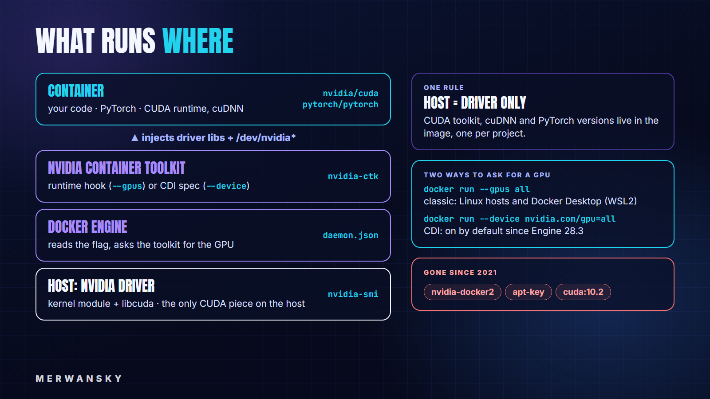
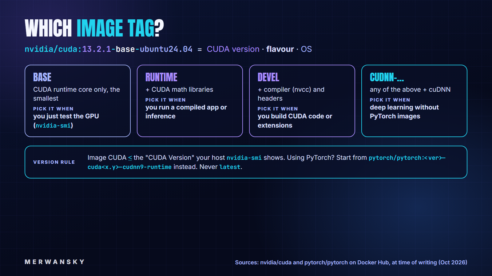

> **TLDR**: Install only the NVIDIA driver on the host, install the NVIDIA Container Toolkit from NVIDIA's current apt repo, run `nvidia-ctk runtime configure --runtime=docker`, and start containers with `--gpus all`. CUDA, cuDNN and PyTorch live in the image, one version per project. In 2026 there is a second way to ask for a GPU, CDI (`--device nvidia.com/gpu=all`), which Docker enables by default. Every command below was run on an Ubuntu box with an RTX 4070, on a Jetson AGX Orin and on Windows 11 with WSL2, and the outputs are real.

Hey there, in 2021 I wrote *How to access NVIDIA GPU from a Docker Container?* [1]. It is one of my most-read articles, and if you follow it today, it breaks: the `nvidia-container-runtime` project its STEP3 installs is archived, its `apt-key` step has been replaced by a `signed-by` keyring, and the images its STEP4 pulls (`nvidia/cuda` and `nvidia/cuda:10.2-cudnn7-devel`) no longer exist [2][6][12][21].

This is the 2026 version, and it covers three things: first, what changed since 2021 and why the old commands break; second, the setup STEP by STEP, from the host driver to Docker Compose and CDI, with every flag explained; and third, the two other machines on my desk (a Jetson and a Windows laptop), Podman vs Docker, and the errors you will most likely hit.

## Why Docker for GPU work?

The motivation has not changed since 2021: installing CUDA, cuDNN and a deep-learning framework directly on your computer works until the second project needs another version [1]. Then you are juggling `LD_LIBRARY_PATH` and reinstalling drivers on a Friday evening.

With containers, the work splits in two:

* **The host** only needs the NVIDIA driver.
* **The image** carries the CUDA user-space libraries, cuDNN, PyTorch and your code, one combination per project [2][6].

Today I run approximately everything in Docker, because a project that runs in a container runs the same way on every machine I use, so it is easy to deploy and to move from one machine to another.



## What changed since 2021

Four things, and each one breaks a step of the old recipe:

* **`nvidia-docker` is archived.** The repository says the project is "superseded by the NVIDIA Container Toolkit", deprecated and archived [7]. The same goes for `nvidia-container-runtime`, whose apt repo my 2021 article used [21].
* **The apt setup changed.** Repos are now added with a `signed-by` keyring instead of `apt-key` [2][8]. Old list files such as `nvidia-docker.list` or `nvidia-container-runtime.list` left on your machine cause a "Conflicting values set for option Signed-By" error on `apt-get update` [3].
* **CUDA image tags expire.** The `latest` tag is deprecated, and tags are deleted after their support lifetime [6]. On 2026-10-23, both `nvidia/cuda:10.2-cudnn7-devel` (used in 2021) and `nvidia/cuda:latest` returned "no such manifest" [12].
* **CDI arrived.** The Container Device Interface describes the GPU device nodes and libraries in a spec file that the container engine reads. The toolkit supports it since v1.12.0 and, since v1.18.0, writes the spec by itself with a `nvidia-cdi-refresh` service [4]. Docker Engine turns CDI on by default since version 28.3.0 [14].

The last point has a side effect you will see below: on a recent Docker Engine without the toolkit, even the classic `--gpus all` first goes through CDI and fails with a message about CDI, not about NVIDIA [12].

## STEP1: check the host driver

NVIDIA recommends installing the driver with your distribution's package manager [2]. Check that it works before touching Docker:

```bash
nvidia-smi --query-gpu=name,driver_version,memory.total --format=csv
```

Expected output on my Ubuntu 24.04 box [12]:

```
name, driver_version, memory.total [MiB]
NVIDIA GeForce RTX 4070 Laptop GPU, 595.99.02, 8188 MiB
```

Also note the "CUDA Version" in the header of a plain `nvidia-smi`: 13.2 here. It tells you which CUDA images match your driver (STEP4).

## STEP2: install Docker Engine

Use Docker's own apt repository, not the `docker.io` package. Remove the old packages first, then add the repo with its keyring [8]:

```bash
# remove distro / older packages (the command skips the ones that are not installed)
sudo apt remove $(dpkg --get-selections docker.io docker-compose docker-compose-v2 docker-doc docker-buildx podman-docker containerd runc | cut -f1)

# Docker's GPG key in its own keyring (no apt-key)
sudo apt update
sudo apt install ca-certificates curl
sudo install -m 0755 -d /etc/apt/keyrings
sudo curl -fsSL https://download.docker.com/linux/ubuntu/gpg -o /etc/apt/keyrings/docker.asc
sudo chmod a+r /etc/apt/keyrings/docker.asc

# the repo, in the deb822 format, pointing at that key
sudo tee /etc/apt/sources.list.d/docker.sources <<EOF
Types: deb
URIs: https://download.docker.com/linux/ubuntu
Suites: $(. /etc/os-release && echo "${UBUNTU_CODENAME:-$VERSION_CODENAME}")
Components: stable
Architectures: $(dpkg --print-architecture)
Signed-By: /etc/apt/keyrings/docker.asc
EOF

sudo apt update
sudo apt install docker-ce docker-ce-cli containerd.io docker-buildx-plugin docker-compose-plugin
```

To run `docker` without `sudo`, add your user to the `docker` group, and know what that means: the group grants root-level privileges on the machine [20].

```bash
sudo usermod -aG docker $USER
newgrp docker          # or log out and in again
```

My box already had Docker Engine 29.4.1 from this repository, so I started from there [12].

## STEP3: install the NVIDIA Container Toolkit

This is the step that changed the most. First, clean up what older guides (mine included) left behind:

```bash
ls /etc/apt/sources.list.d/              # look for nvidia-docker.list, nvidia-container-runtime.list
sudo rm -f /etc/apt/sources.list.d/nvidia-docker.list \
           /etc/apt/sources.list.d/nvidia-container-runtime.list
sudo apt-get purge -y nvidia-docker2 nvidia-container-runtime   # if they are installed
```

Then add NVIDIA's repo with a `signed-by` keyring and install a pinned version (1.20.1-1 at the time of writing) [2]:

```bash
curl -fsSL https://nvidia.github.io/libnvidia-container/gpgkey \
  | sudo gpg --dearmor -o /usr/share/keyrings/nvidia-container-toolkit-keyring.gpg
curl -s -L https://nvidia.github.io/libnvidia-container/stable/deb/nvidia-container-toolkit.list \
  | sed 's#deb https://#deb [signed-by=/usr/share/keyrings/nvidia-container-toolkit-keyring.gpg] https://#g' \
  | sudo tee /etc/apt/sources.list.d/nvidia-container-toolkit.list

sudo apt-get update
export NVIDIA_CONTAINER_TOOLKIT_VERSION=1.20.1-1
sudo apt-get install -y \
  nvidia-container-toolkit=${NVIDIA_CONTAINER_TOOLKIT_VERSION} \
  nvidia-container-toolkit-base=${NVIDIA_CONTAINER_TOOLKIT_VERSION} \
  libnvidia-container-tools=${NVIDIA_CONTAINER_TOOLKIT_VERSION} \
  libnvidia-container1=${NVIDIA_CONTAINER_TOOLKIT_VERSION}

nvidia-ctk --version
```

```
NVIDIA Container Toolkit CLI version 1.20.1
```

Now tell Docker about the NVIDIA runtime and restart it [2]:

```bash
sudo nvidia-ctk runtime configure --runtime=docker   # writes the "nvidia" runtime into /etc/docker/daemon.json
sudo systemctl restart docker
```

On my box `daemon.json` already contained the `nvidia` runtime entry, left over from an older install, so the file did not change. What was missing was the toolkit itself [12]: a half-configured state that produces two of the errors in the Troubleshooting section.

## STEP4: run your first GPU container

```bash
docker run --rm --gpus all nvidia/cuda:13.2.1-base-ubuntu24.04 nvidia-smi
```

```
+-----------------------------------------------------------------------------------------+
| NVIDIA-SMI 595.99.02              Driver Version: 595.99.02      CUDA Version: 13.2     |
+-----------------------------------------+------------------------+----------------------+
|   0  NVIDIA GeForce RTX 4070 ...    Off |   00000000:01:00.0 Off |                  N/A |
| N/A   41C    P8              2W /  115W |     101MiB /   8188MiB |      0%      Default |
+-----------------------------------------+------------------------+----------------------+
```

(Output shortened to the useful lines [12].) The flags:

```bash
--rm                  # delete the container when it exits
--gpus all            # give the container every GPU of the host
```

You can be more selective [5]:

```bash
docker run --rm --gpus device=0 nvidia/cuda:13.2.1-base-ubuntu24.04 nvidia-smi -L
# GPU 0: NVIDIA GeForce RTX 4070 Laptop GPU (UUID: GPU-...)

docker run --rm --gpus '"device=0"' -e NVIDIA_DRIVER_CAPABILITIES=utility \
  nvidia/cuda:13.2.1-base-ubuntu24.04 nvidia-smi --query-gpu=name,driver_version --format=csv
# NVIDIA GeForce RTX 4070 Laptop GPU, 595.99.02
```

```bash
--gpus device=0                          # only GPU 0 (an index or a GPU UUID)
--gpus '"device=0,2"'                    # several GPUs: note the two levels of quotes
-e NVIDIA_DRIVER_CAPABILITIES=utility    # only the driver parts nvidia-smi needs, not compute
```

And without the flag? The container starts without any GPU, and `nvidia-smi` is not even there, because the driver tools are injected by the toolkit, not shipped in the image [12]:

```bash
docker run --rm nvidia/cuda:13.2.1-base-ubuntu24.04 nvidia-smi
# exec: "nvidia-smi": executable file not found in $PATH
```

### Which image tag?

The `nvidia/cuda` tag reads as CUDA version, flavour and OS. Pick the smallest flavour that does the job [6]:



* `base` has the CUDA runtime only, enough to test the GPU.
* `runtime` adds the CUDA math libraries, for running compiled apps.
* `devel` adds the compiler and headers, for building CUDA code.
* The `cudnn` variants are the same with cuDNN added.

The safe rule: the image's CUDA version should not be higher than the "CUDA Version" your host's `nvidia-smi` shows.

I expected the opposite case to fail, so I tested it: a `13.4.3` image on my 13.2 driver. It ran. The reason is that the image ships NVIDIA's CUDA forward-compatibility library, which the container picked up before the host's, and `cuInit` returned success [12]. Don't build on that, though: NVIDIA documents forward compatibility only for data-center GPUs, selected NGC-ready RTX cards and Jetson boards [15]. On a GeForce card it worked on my machine on that day, which is not a guarantee. Match the image to the driver.

## STEP5: PyTorch with your own project

In 2021 I built PyTorch from a `cuda` base image and pinned `torch` by hand [1]. Today the PyTorch team publishes images per CUDA version, so start from one that matches your driver: `pytorch/pytorch:2.14.1-cuda13.2-cudnn9-runtime` here [9].

A small check script, `project/check_gpu.py`:

```python
import torch
print("torch", torch.__version__, "| CUDA build", torch.version.cuda)
print("cuda available:", torch.cuda.is_available())
print("device:", torch.cuda.get_device_name(0))
x = torch.randn(4096, 4096, device="cuda")
print("matmul ok:", (x @ x).shape, "| GPU memory MiB:", torch.cuda.memory_allocated() // 2**20)
```

Run it with your project folder mounted:

```bash
docker run --rm --gpus all -u $(id -u):$(id -g) -v $PWD/project:/workspace -w /workspace \
  pytorch/pytorch:2.14.1-cuda13.2-cudnn9-runtime python check_gpu.py
```

```
torch 2.14.1+cu132 | CUDA build 13.2
cuda available: True
device: NVIDIA GeForce RTX 4070 Laptop GPU
matmul ok: torch.Size([4096, 4096]) | GPU memory MiB: 72
```

The flags, updated from the 2021 table [1]:

```bash
--gpus all                  # GPU access
-u $(id -u):$(id -g)        # run as your user, so files written to the mount are yours, not root's
-v $PWD/project:/workspace  # share the project folder between host and container
-w /workspace               # start in that folder
-p 8888:8888                # (if you run Jupyter) publish the container port on the host
```

When the project needs more packages, write a Dockerfile on top of the same image:

```dockerfile
FROM pytorch/pytorch:2.14.1-cuda13.2-cudnn9-runtime
# torch + CUDA user-space libraries come with the image; the host only provides the driver
# the image Python is "externally managed" (PEP 668): allow pip in this single-purpose image
ENV PIP_BREAK_SYSTEM_PACKAGES=1
RUN pip install --no-cache-dir opencv-python-headless
WORKDIR /workspace
COPY check_gpu.py .
CMD ["python", "check_gpu.py"]
```

```bash
docker build -t gpu-project:0.1 .
docker run --rm --gpus all gpu-project:0.1 python -c "import cv2, torch; print(cv2.__version__, torch.cuda.is_available())"
# 5.0.0 True
```

One trap I hit: a plain `pip install` in this image fails, because its Python is marked "externally managed" (PEP 668), and `python -m venv` fails too [9][12]. In a single-purpose image, `PIP_BREAK_SYSTEM_PACKAGES=1` is a reasonable way out, and it keeps the image's CUDA build of PyTorch.

## STEP6: Docker Compose

For anything you run more than once, put it in a `compose.yaml`. The GPU goes under `deploy.resources.reservations.devices` [10]:

```yaml
services:
  trainer:
    image: pytorch/pytorch:2.14.1-cuda13.2-cudnn9-runtime
    command: python /workspace/check_gpu.py
    volumes:
      - ./project:/workspace
    deploy:
      resources:
        reservations:
          devices:
            - driver: nvidia
              count: all            # or device_ids: ["0"], not both
              capabilities: [gpu]   # required, the request fails without it
```

```bash
docker compose up --abort-on-container-exit
```

```
trainer-1  | torch 2.14.1+cu132 | CUDA build 13.2
trainer-1  | cuda available: True
trainer-1  | device: NVIDIA GeForce RTX 4070 Laptop GPU
trainer-1  | matmul ok: torch.Size([4096, 4096]) | GPU memory MiB: 72
trainer-1 exited with code 0
```

`count` and `device_ids` are mutually exclusive, and `capabilities` must be set [10].

## STEP7: CDI, the 2026 way (optional)

With `--gpus`, the toolkit injects the GPU through a hook when the container starts. With CDI, the device nodes, libraries and mounts are written in a spec file, and the container engine applies them like any other device [4].

With toolkit 1.18 or newer you don't have to generate anything: right after the install, `nvidia-cdi-refresh` had already written `/var/run/cdi/nvidia.yaml` on my box [4][12]. List what it exposes:

```bash
nvidia-ctk cdi list
```

```
level=info msg="Found 3 CDI devices"
nvidia.com/gpu=0
nvidia.com/gpu=GPU-<uuid>
nvidia.com/gpu=all
```

Then request a device by its CDI name with `--device`:

```bash
docker run --rm --device nvidia.com/gpu=all nvidia/cuda:13.2.1-base-ubuntu24.04 nvidia-smi -L
# GPU 0: NVIDIA GeForce RTX 4070 Laptop GPU (UUID: GPU-...)

docker run --rm --device nvidia.com/gpu=0 nvidia/cuda:13.2.1-base-ubuntu24.04 \
  nvidia-smi --query-gpu=name --format=csv,noheader
# NVIDIA GeForce RTX 4070 Laptop GPU
```

No extra Docker setting was needed: CDI is on by default since Engine 28.3.0, and it reads specs from `/etc/cdi` and `/var/run/cdi` [14]. If the spec is ever missing (older toolkit), generate it by hand with `sudo nvidia-ctk cdi generate --output=/etc/cdi/nvidia.yaml` [4].

Why bother when `--gpus` works? Because the GPU becomes part of the container's configuration instead of a late hook, which is also NVIDIA's suggested fix for containers that lose their GPU (see Troubleshooting) [3][4]. It is also how Podman requests GPUs [2].

## Docker or Podman?

Podman is a daemonless container engine with a CLI "familiar to anyone who has used the Docker Container Engine", and it runs containers as root or as a normal user [16]. For the GPU, NVIDIA recommends CDI with Podman [2], with the same device names as above [4]:

```bash
podman run --rm --device nvidia.com/gpu=all --security-opt=label=disable ubuntu nvidia-smi -L
```

The main differences, and what they mean for GPU work:

| | Docker | Podman |
| --- | --- | --- |
| Architecture | a daemon (`dockerd`) runs the containers [18] | daemonless [16] |
| Root | members of the `docker` group effectively have root [20]; a rootless mode exists [18] | runs as root or as a normal user [16] |
| GPU request | `--gpus all` or CDI `--device` [5][14] | CDI `--device` (recommended) [2][4], `--gpus` also accepted [17] |
| Compose | `docker compose`, GPU reservations documented [10] | compatible CLI; check your compose tool's GPU support |
| Windows / WSL2 | Docker Desktop with GPU support [11] | not covered here |

**PROS of Docker:** the most documented path for GPUs (NVIDIA, Docker and the PyTorch images all show Docker commands), Compose GPU support out of the box, the same commands on Linux and Windows. **CONS:** a root daemon, and the `docker` group is a root-equivalent permission [20].

**PROS of Podman:** no daemon, rootless containers (running as a normal user is exactly what rootless setups use to limit the damage of a vulnerability [18]), and CDI as the recommended GPU path [2]. **CONS:** in the documentation used here, Compose GPU reservations and Windows GPU support are written for Docker [10][11], so on those paths you translate the commands yourself.

If you want Docker without the root daemon, there is rootless mode, which runs the daemon and the containers as a normal user [18]; NVIDIA's install guide gives the extra `nvidia-ctk` steps (a per-user `daemon.json` and `no-cgroups`) [2]. I tested neither Podman nor rootless Docker for this article: all my machines run Docker.

## Two other machines: a Jetson and Windows

### Jetson AGX Orin (JetPack 5)

On a Jetson the GPU is integrated, there is no `nvidia-smi`, and the toolkit runs in "CSV mode" [12]. JetPack 5.1.2 ships its own toolkit (1.11.0-rc.1 on mine), and the desktop flag fails with a clear message:

```bash
docker run --rm --gpus all nvcr.io/nvidia/l4t-pytorch:r35.2.1-pth2.0-py3 true
# Auto-detected mode as 'csv'
# invoking the NVIDIA Container Runtime Hook directly (e.g. specifying the docker --gpus flag)
# is not supported. Please use the NVIDIA Container Runtime instead.
```

Use the runtime instead [13]:

```bash
docker run --rm --runtime nvidia nvcr.io/nvidia/l4t-pytorch:r35.2.1-pth2.0-py3 \
  python3 -c 'import torch; print(torch.__version__, torch.cuda.is_available(), torch.cuda.get_device_name(0))'
# 2.0.0a0+ec3941ad.nv23.02 True Orin
```

In Compose that is one line, `runtime: nvidia`, which is how the Ollama container on my Jetson gets its GPU [12]. Two more differences: pick an `l4t-*` image whose tag matches your JetPack/L4T version [13], and CDI is not available here (`nvidia-ctk` 1.11 has no `cdi` command, and Docker Engine 28.1 predates the CDI default) [12][14].

### Windows 11 with WSL2

On Windows, install the NVIDIA driver on Windows only, never inside WSL2, and use Docker Desktop with the WSL2 backend; run `wsl --update` to get a current WSL kernel [11]. Then the Linux commands work as they are. On my laptop (NVIDIA T600, 4 GB, Docker Desktop engine 29.7.2) [12]:

```bash
docker run --rm --gpus all nvcr.io/nvidia/k8s/cuda-sample:nbody nbody -gpu -benchmark
```

```
> Compute 7.5 CUDA device: [NVIDIA T600 Laptop GPU]
14336 bodies, total time for 10 iterations: 33.621 ms
= 61.128 billion interactions per second
```

The PyTorch check and the same `compose.yaml` from STEP5 and STEP6 ran unchanged and printed `device: NVIDIA T600 Laptop GPU` [12]. CDI did not: `--device nvidia.com/gpu=all` failed with "unresolvable CDI devices", so stay with `--gpus` on Docker Desktop [11][12].

## Troubleshooting

Here are the errors I ran into while testing for this article, and the others you are likely to meet.

**`failed to discover GPU vendor from CDI: no known GPU vendor found`** on `docker run --gpus all`. Seen on Docker Engine 29 with no toolkit installed [12]. Fix: STEP3.

**`exec: "nvidia-container-runtime": executable file not found in $PATH`** on `--runtime=nvidia`. The runtime is declared in `daemon.json` (on my box, a leftover from an older install) but its package is missing [12]. Fix: STEP3.

**`CDI device injection failed: unresolvable CDI devices nvidia.com/gpu=all`.** No CDI spec on this machine: no toolkit, a toolkit older than 1.18, or Docker Desktop on Windows [4][12]. Fix: install the toolkit, generate the spec, or use `--gpus` on Windows.

**`nvidia-smi: executable file not found`** inside the container. You forgot `--gpus` (or `--runtime nvidia` on a Jetson) [12].

**`Conflicting values set for option Signed-By`** on `apt-get update`. Two list files point to the same NVIDIA repo with different keys, usually a leftover from an old guide [3]. Fix: delete the old `nvidia-docker.list` / `nvidia-container-runtime.list` (STEP3).

**`Failed to initialize NVML: Unknown Error`** in a container that worked before. NVIDIA's explanation: with systemd managing cgroups, even a `systemctl daemon-reload` can remove the container's access to GPUs that were injected by the hook [3]. NVIDIA's fix is to delete the container: when it is started again, it regains the GPU; to avoid it, NVIDIA lists requesting the GPU through CDI, passing the device nodes explicitly, or switching Docker to the `cgroupfs` driver [3]. I have not reproduced this one on purpose, so take the fix from NVIDIA's page rather than from me.

## Key take-aways

After reading this article you should be able to answer for yourself, and why not explain to others, the following:

* Why the host needs only the NVIDIA driver, and the CUDA version lives in the image.
* How to install the NVIDIA Container Toolkit in 2026, and which leftovers from older guides to remove first.
* The difference between `--gpus all` and CDI's `--device nvidia.com/gpu=all`, and which one to use on Linux, on a Jetson and on Windows.
* How to choose an `nvidia/cuda` or `pytorch/pytorch` tag that matches your driver.
* When Podman or rootless Docker is worth the switch, and what you give up.

As always to end this article, here is the "***Quote of the Article***":

> **"The price of reliability is the pursuit of the utmost simplicity."** (C. A. R. Hoare [19])

The 2021 recipe needed a separate runtime package, a hand-made repo and a pinned CUDA tag; the 2026 one is a driver, a toolkit and one flag. Keep it that simple, and pin every tag.

Cheers

Merwansky

---

*This article was drafted with AI assistance from the 2021 article, the documentation listed below and the author's test runs and answers, and reviewed and completed by the author.*

## Sources

1. M. Birem, *How to access NVIDIA GPU from a Docker Container?*, Medium, 2021. https://medium.com/@just-merwan/how-to-access-nvidia-gpu-from-a-docker-container-e22489475882
2. NVIDIA, *Installing the NVIDIA Container Toolkit* (v1.20.1-1). https://docs.nvidia.com/datacenter/cloud-native/container-toolkit/latest/install-guide.html
3. NVIDIA, *Troubleshooting*, NVIDIA Container Toolkit 1.20.1. https://docs.nvidia.com/datacenter/cloud-native/container-toolkit/1.20.1/troubleshooting.html
4. NVIDIA, *Support for Container Device Interface*, NVIDIA Container Toolkit. https://docs.nvidia.com/datacenter/cloud-native/container-toolkit/latest/cdi-support.html
5. Docker, *GPU access* (Docker Engine). https://docs.docker.com/engine/containers/gpu/
6. NVIDIA, *nvidia/cuda* image, Docker Hub. https://hub.docker.com/r/nvidia/cuda
7. NVIDIA, *nvidia-docker* repository (archived), GitHub. https://github.com/NVIDIA/nvidia-docker
8. Docker, *Install Docker Engine on Ubuntu*. https://docs.docker.com/engine/install/ubuntu/
9. PyTorch, *pytorch/pytorch* image tags, Docker Hub. https://hub.docker.com/r/pytorch/pytorch/tags
10. Docker, *Enable GPU access with Docker Compose*. https://docs.docker.com/compose/how-tos/gpu-support/
11. Docker, *GPU support in Docker Desktop for Windows*. https://docs.docker.com/desktop/features/gpu/
12. M. Birem, *Run logs for this article*: Ubuntu 24.04 + RTX 4070 Laptop (driver 595.99.02, Docker Engine 29.4.1, toolkit 1.20.1), Jetson AGX Orin (JetPack 5.1.2, Engine 28.1.1), Windows 11 + WSL2 (T600 Laptop, driver 596.71, Docker Desktop 29.7.2), run on 2026-10-22/23. Full logs available upon request.
13. NVIDIA, *l4t-pytorch* container, NGC catalog. https://catalog.ngc.nvidia.com/orgs/nvidia/containers/l4t-pytorch
14. Docker, *dockerd* reference (CDI enabled by default since Docker Engine 28.3.0). https://docs.docker.com/reference/cli/dockerd/
15. NVIDIA, *CUDA Compatibility: Forward Compatibility*. https://docs.nvidia.com/deploy/cuda-compatibility/forward-compatibility.html
16. Podman, *What is Podman?* (documentation home). https://docs.podman.io/en/latest/index.html
17. Podman, *podman-run* (`--gpus`, `--device`). https://docs.podman.io/en/latest/markdown/podman-run.1.html
18. Docker, *Rootless mode*. https://docs.docker.com/engine/security/rootless/
19. C. A. R. Hoare, *The Emperor's Old Clothes* (1980 ACM Turing Award lecture), Communications of the ACM 24(2), 75–83, 1981. https://doi.org/10.1145/358549.358561
20. Docker, *Linux post-installation steps for Docker Engine* (the `docker` group grants root-level privileges). https://docs.docker.com/engine/install/linux-postinstall/
21. NVIDIA, *nvidia-container-runtime* repository (archived, superseded by the NVIDIA Container Toolkit), GitHub. https://github.com/NVIDIA/nvidia-container-runtime

_Accessed 2026-10-23._
