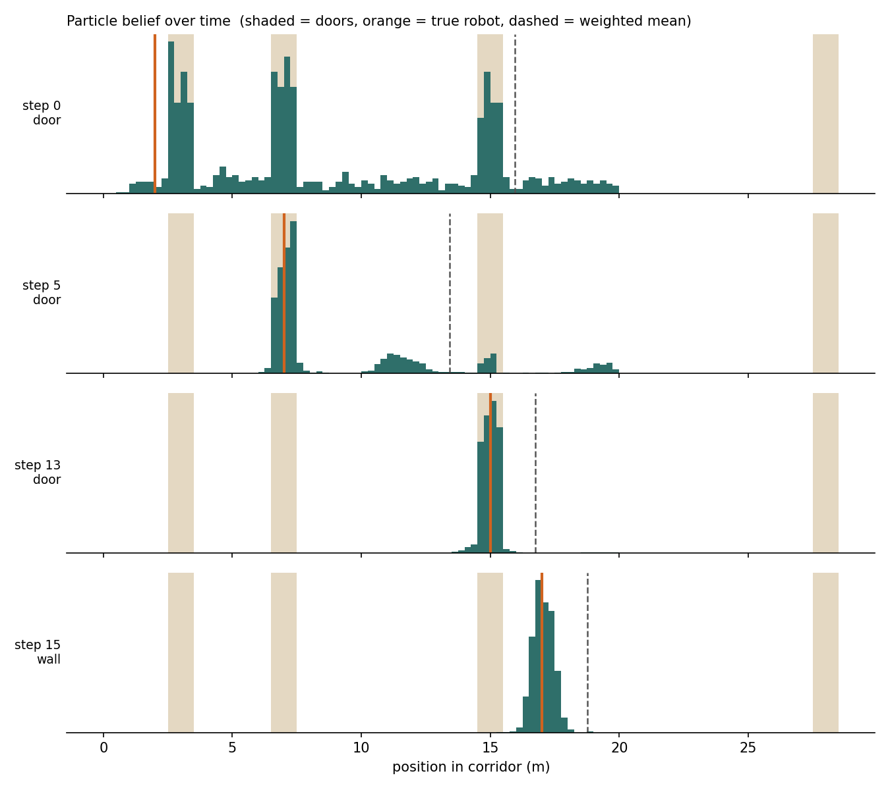

<!-- Synced 2026-10-10 from the Cowork draft minus placeholders. The published Medium version is the final wording; re-import it before the site goes live (WP4). -->

## Particle Filters Explained: When the Kalman Filter Isn't Enough

### How a robot that has no idea where it is can find itself with a cloud of guesses, a sensor that lies and 40 lines of NumPy


> **TLDR**: A particle filter tracks a state by keeping hundreds or thousands of guesses ("particles"), moving them with the motion model, weighting them by how well they explain each measurement, and resampling the good ones. Unlike the Kalman filter, it does not assume a single Gaussian, so it can hold several hypotheses at once. That is exactly what a robot needs when it does not yet know where it is.

Hey there, in my last article we looked at the Kalman filter and how your phone fuses noisy sensors into one clean position. I ended it with a one-line warning: for non-linear systems use the EKF or UKF, and for multimodal or non-Gaussian noise use particle filters.

This article is about that last line. Three things are covered: first, why the Kalman filter breaks down in some very ordinary situations; second, how a particle filter works, step by step, with code you can run; and third, what goes wrong when you use one on a real robot and how people fix it.

## What is the Problem?

Imagine a robot switched on somewhere in a 20-metre corridor. It has a wheel odometer, so it knows roughly how far it drives. It also has a cheap sensor that tells it, at each step, "I see a door" or "I see a wall". The sensor is right 90% of the time. The corridor has three doors, at 3 m, 7 m and 15 m.

The robot sees a door. Where is it?

The honest answer is: probably near one of the three doors, and we can't tell which yet. That belief has **three peaks**. A Kalman filter can only describe one peak: a mean and a variance. Ask it to summarise "near door 1, door 2 or door 3" and the best it can do is a wide bell centred somewhere around 8–9 m, which is the one place the robot is least likely to be.

This is the **multimodal** problem, and it is not exotic. It shows up whenever the world is ambiguous:

* a robot in a building with many identical corridors (global localisation),
* a robot that was picked up and moved (the "kidnapped robot" problem),
* a tracker that briefly loses an object behind an occlusion and must consider several places it could reappear.

The second problem is **non-linearity**. The EKF linearises the model around the current estimate. When the model bends sharply, or the estimate is far from the truth, that linearisation is wrong and the filter can diverge.


## The Intuition: Many Guesses Instead of One

The particle filter takes a blunt but powerful approach: instead of describing the belief with a formula, it **samples** it. Each particle is one concrete guess, "the robot is at 7.2 m", and the density of particles in a region represents how likely that region is.

The idea goes back to Gordon, Salmond and Smith, who introduced it in 1993 as the *bootstrap filter* [1]. Dellaert, Fox, Burgard and Thrun brought it to mobile robots in 1999 as **Monte Carlo Localization (MCL)**, and showed it was faster, more accurate and lighter on memory than the grid-based methods of the time [2].

The loop has the same rhythm as the Kalman filter, plus one extra step:

```
  particles (guesses) + weights
             │
             ▼
     ┌───────────────┐
     │    PREDICT    │  ← move every particle with the motion model + noise
     └───────┬───────┘
             ▼
     ┌───────────────┐
     │    WEIGHT     │  ← score each particle: how well does it explain
     └───────┬───────┘     the measurement z? (likelihood p(z | x))
             ▼
     ┌───────────────┐
     │   RESAMPLE    │  ← clone the good guesses, drop the bad ones
     └───────┬───────┘     (only when the weights get too uneven)
             ▼
     estimate = weighted mean, or the densest cluster
```

* **Predict**: every particle moves by the odometry reading plus random noise. The noise is important: it spreads the cloud the same way uncertainty grows when you drive blind.
* **Weight**: every particle is scored with the measurement likelihood. A particle standing in front of a door gets weight 0.9 when the sensor says "door", and 0.1 otherwise.
* **Resample**: draw a new set of particles in proportion to the weights. Likely guesses get copied, unlikely ones disappear.

No matrix inversion, no Jacobians, no Gaussian assumption. The motion and sensor models can be anything you can *simulate* and *score*.

## Python Implementation from Scratch

Here is the corridor robot, complete. It runs with only NumPy.

```python
import numpy as np

rng = np.random.default_rng(42)

# --- The world: a 20 m corridor with three doors (centres in metres) ---
CORRIDOR = 20.0
DOORS = np.array([3.0, 7.0, 15.0])
DOOR_HALF_WIDTH = 0.5

def door_likelihood(x):
    """Probability that the sensor says 'door' at position x."""
    near = np.min(np.abs(x[:, None] - DOORS[None, :]), axis=1) < DOOR_HALF_WIDTH
    return np.where(near, 0.9, 0.1)          # sensor is right 90% of the time

# --- Particle filter ---
N = 1000
particles = rng.uniform(0, CORRIDOR, N)       # global uncertainty: anywhere
weights = np.full(N, 1.0 / N)

def predict(particles, u, motion_std=0.2):
    """Move every particle by the odometry u plus noise."""
    return particles + u + rng.normal(0, motion_std, particles.size)

def update(weights, particles, saw_door):
    """Reweight particles by how well they explain the measurement."""
    p_door = door_likelihood(particles)
    likelihood = p_door if saw_door else 1.0 - p_door
    inside = (particles >= 0) & (particles <= CORRIDOR)   # the robot can't be in a wall
    w = weights * likelihood * inside
    return w / w.sum()

def effective_n(weights):
    return 1.0 / np.sum(weights ** 2)

def systematic_resample(particles, weights):
    """Low-variance resampling: one random offset, N evenly spaced pointers."""
    n = particles.size
    positions = (rng.random() + np.arange(n)) / n
    idx = np.searchsorted(np.cumsum(weights), positions)
    idx = np.minimum(idx, n - 1)               # guard against round-off
    return particles[idx], np.full(n, 1.0 / n)

# --- Simulate the true robot ---
true_x = 1.0
for step in range(16):
    u = 1.0                                       # robot drives 1 m forward
    true_x = min(true_x + u, CORRIDOR)
    saw_door = rng.random() < door_likelihood(np.array([true_x]))[0]

    particles = predict(particles, u)
    weights = update(weights, particles, saw_door)
    if effective_n(weights) < N / 2:
        particles, weights = systematic_resample(particles, weights)

    estimate = np.sum(weights * particles)
    spread = np.sqrt(np.sum(weights * (particles - estimate) ** 2))
    print(f"step {step:2d}  true {true_x:5.2f} m  door={int(saw_door)}  "
          f"estimate {estimate:5.2f} m  ±{spread:4.2f}")
```

A few lines deserve a comment:

```
rng.uniform(0, CORRIDOR, N)      # "I could be anywhere": global localisation
particles + u + rng.normal(...)  # motion model: odometry plus drift
weights * likelihood * inside    # Bayes' rule, one particle at a time
effective_n(weights) < N / 2     # resample only when weights are too uneven
np.searchsorted(cumsum, ...)     # systematic resampling in one vectorised line
```

Running it prints (abridged):

```
step  0  true  2.00 m  door=1  estimate  9.01 m  ±5.35
step  5  true  7.00 m  door=1  estimate 10.39 m  ±4.19
step 11  true 13.00 m  door=0  estimate 13.40 m  ±1.33
step 13  true 15.00 m  door=1  estimate 15.02 m  ±0.47
step 15  true 17.00 m  door=0  estimate 17.06 m  ±0.37
```



*Particle belief at four moments. Shaded bands are doors, the orange line is the true robot, the dashed line is the weighted mean. Original figure, generated with the code above.*

Look at the figure from top to bottom; it tells the whole story:

* **Step 0.** The robot is at 2 m, between doors, but the sensor says "door". The sensor lied, which happens 10% of the time. The particles pile up in front of all three doors. The weighted mean sits at 9 m, in the middle of nowhere. This is why the mean alone is a poor summary of a multimodal belief.
* **Step 5.** The robot drove past a wall stretch and saw door 2. The cluster at 7 m now dominates, but a few other hypotheses survive, because the evidence is not yet conclusive.
* **Step 13.** A second door, eight metres after the first one, is only consistent with "doors at 7 m and 15 m". One cluster is left.
* **Step 15.** The robot has localised itself to about ±0.4 m, and the remaining spread mostly reflects the motion noise.

A Kalman filter started with the same information could not have survived step 0: it would have committed to one bell curve and been pulled towards the wrong place by the false reading.

## What Goes Wrong in Practice (and the Fixes)

The ten-line version above works. On a real robot, four problems show up quickly.

### 1. Weight degeneracy

After a few updates, a handful of particles carry almost all the weight and the rest are wasted computation. The standard health check is the **effective sample size**, N_eff = 1 / Σ w². With equal weights it equals N; when one particle has all the weight it drops to 1. Resampling only when N_eff falls below a threshold (N/2 is the common rule of thumb) keeps the cloud healthy without throwing information away at every step [3].

### 2. Which resampling scheme?

Multinomial resampling (drawing N times at random) is the textbook version but adds unnecessary noise. Systematic resampling, also known as the *low-variance sampler* in *Probabilistic Robotics* [4], uses one random number and N evenly spaced pointers. It is O(N), simple and the usual default. Douc, Cappé and Moulines compared the schemes formally: residual and stratified resampling provably improve on multinomial; systematic usually does well in practice but has no such guarantee [5].

### 3. Sample impoverishment

Resampling copies good particles, so after a while many particles are identical. If the motion noise is very small, the cloud can collapse onto a wrong hypothesis and never recover. Fixes: keep realistic motion noise (the code uses 0.2 m per step), add a little "roughening" jitter after resampling, and inject a few random particles across the map so the robot can recover if it is kidnapped [4].

### 4. How many particles?

Too few and you miss the true pose; too many and you burn CPU. Fox's **KLD-sampling** adapts N on the fly: many particles while the robot is lost, few once the belief is concentrated [6]. This is the "adaptive" in **AMCL**, the localisation node most ROS robots use: its package describes it as adaptive (KLD-sampling) Monte Carlo localisation against a known map with a 2D laser [7], and the Nav2 version is a port of it without algorithmic changes [8].


## Particle Filter vs. Kalman Filter

| | Kalman / EKF / UKF | Particle filter |
| --- | --- | --- |
| Belief shape | One Gaussian | Any shape, several peaks |
| Models | Linear (KF) or locally linearised (EKF) | Anything you can simulate and score |
| Cost | Tiny: a few matrix operations | Grows with N: hundreds to thousands of particles |
| Best for | Smooth tracking, good initial guess, IMU/GPS fusion | Global localisation, ambiguity, kidnapping, strongly non-linear sensors |
| Main weakness | Fails silently on multimodal beliefs | Particles needed grow quickly with state dimension |

The last row matters. Covering a 1D corridor takes 1,000 particles; covering a full 6-DoF pose or a whole map that way would take far too many. That is why real systems combine both. **FastSLAM**, for example, uses particles for the robot's path and a small EKF per landmark inside each particle [9]. When the state is high-dimensional and the belief is unimodal, a Kalman-type filter or a pose-graph optimiser (the topic of my [Visual SLAM article](https://medium.com/@just-merwan)) is the better tool.


## Key Take-Aways

After reading this article you should be able to answer for yourself, and why not explain to others, the following:

* Why a single Gaussian (Kalman filter) cannot represent "the robot is near door 1, 2 or 3", and why the mean of such a belief can be the worst estimate.
* The three steps of a particle filter: **predict** with noise, **weight** with the measurement likelihood, **resample** when N_eff drops.
* How to spot and fix the four classic problems: degeneracy, resampling noise, impoverishment and the particle count (KLD-sampling, as used in AMCL).
* When to choose a particle filter, and when an EKF or pose-graph method is the better fit.

Feeling like the filter clicked? Change `DOORS` to four evenly spaced doors, `[3, 8, 13, 18]`, and run it again. The spread stays at ±2.5 m or more for most of the run: from the robot's point of view, every door looks the same as the next. The filter only settles near the end of the corridor, when the hypotheses further ahead would put the robot inside the end wall. That is the limit of any filter: it cannot invent information the sensors don't give.

As always to end this article, here is the "***Quote of the Article***":

> **"All models are wrong, but some are useful."** — George E. P. Box

The particle filter takes that quote literally: it keeps a thousand wrong models alive and lets the data decide which ones are useful.


Cheers

Merwansky

---

*This article was drafted with AI assistance and reviewed, tested and completed by the author. The code was run and the figure generated by the author.*

## Sources

1. N. J. Gordon, D. J. Salmond, A. F. M. Smith, "Novel approach to nonlinear/non-Gaussian Bayesian state estimation," *IEE Proceedings F*, 140(2), 107–113, 1993. https://www.fs.isy.liu.se/Edu/Courses/ObserversPhD/CourseMaterial/gordon_particle.pdf
2. F. Dellaert, D. Fox, W. Burgard, S. Thrun, "Monte Carlo Localization for Mobile Robots," *Proc. IEEE ICRA*, vol. 2, 1322–1328, 1999. https://publications.ri.cmu.edu/monte-carlo-localization-for-mobile-robots
3. M. S. Arulampalam, S. Maskell, N. Gordon, T. Clapp, "A tutorial on particle filters for online nonlinear/non-Gaussian Bayesian tracking," *IEEE Transactions on Signal Processing*, 50(2), 174–188, 2002. https://ieeexplore.ieee.org/abstract/document/978374
4. S. Thrun, W. Burgard, D. Fox, *Probabilistic Robotics*, MIT Press, 2005.
5. R. Douc, O. Cappé, E. Moulines, "Comparison of Resampling Schemes for Particle Filtering," 2005. https://arxiv.org/abs/cs/0507025
6. D. Fox, "Adapting the sample size in particle filters through KLD-sampling," *International Journal of Robotics Research*, 2003. https://rse-lab.cs.washington.edu/projects/mcl/abstracts/adaptive-ijrr-2003.abstract.html
7. ROS `amcl` package description (navigation stack, noetic). https://raw.githubusercontent.com/ros-planning/navigation/noetic-devel/amcl/package.xml
8. Nav2 `nav2_amcl` package. https://index.ros.org/p/nav2_amcl/
9. M. Montemerlo, S. Thrun, D. Koller, B. Wegbreit, "FastSLAM: A Factored Solution to the Simultaneous Localization and Mapping Problem," *AAAI*, 2002. https://people.csail.mit.edu/ruijie/6834/FastSLAM_thrun_AAAI02.pdf

_Accessed 2026-10-09._
