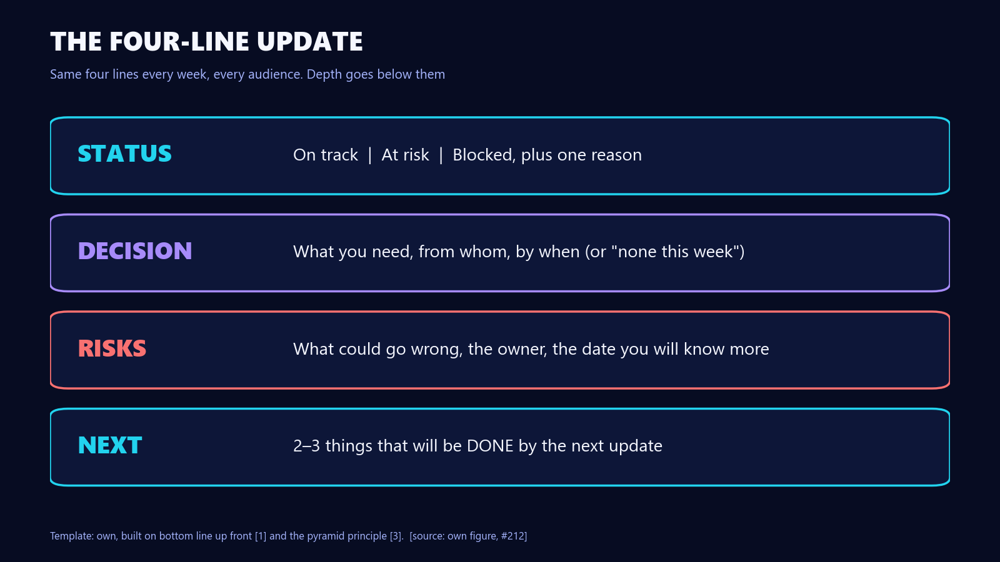

> **TLDR**: Most engineering updates are told in the order the work happened: what we tried, what broke, what we fixed, and, at the very end, what we need. Leaders read them in the opposite order. Put the bottom line up front, a rule the US Army has written into its correspondence regulation [1], then use the same four lines every time: status, decision needed, risks, next. Adapt the depth to the audience (steering committee, one-to-one, team sync), and when you can, show the thing working instead of describing it.

Hey there, this one is about the update you give every week and probably never think about.

In this article three things are covered: first, why a good technical update gets lost on its way to leadership; second, "answer first" and a four-line template you can reuse; and third, how to adapt it to email, steering committees, one-to-ones and team syncs.

If you're looking for how to build a presentation (audience, key message, slides), that's in [How to Turn Complex Ideas Into Clear, Engaging Stories](https://just-merwan.medium.com/how-to-turn-complex-ideas-into-clear-engaging-stories-a364df8a1a1b). For pauses and delivery, see [How to Organize Your Thoughts, Speak with Impact, and Connect with Confidence](https://just-merwan.medium.com/how-to-organize-your-thoughts-speak-with-impact-and-connect-with-confidence-909dfe327128). This article is about the recurring status update.

## Picture this

*A made-up scene, but you have probably lived a version of it.*

Monday, steering committee, 30 minutes on the agenda for five projects. Sara, the lead engineer on a vision inspection project, gets her six minutes.

"So, last week we retrained the model on the new batch of images. The first run didn't converge because the labels from the supplier had a different format, so we wrote a converter, and then we noticed the lighting at line 3 is different from line 1, so we…"

At minute four, the plant manager checks his phone. At minute five, the chair says "thanks Sara, let's move on". The one thing Sara needed, a decision on whether to buy a second camera for line 3 before the supplier's price changes on Friday, was on her last slide. Nobody saw it.

Nothing in her update was wrong. It was in the wrong order.

## Why technical updates get lost

Engineers tell the story the way they lived it: chronologically. That order makes sense to the person who did the work, because each step explains the next.

The person reading or listening is asking something else: *Is it on track? Do you need something from me? Should I worry?* If the answer comes last, the reader has to hold the whole story in their head to find it, and in a meeting with five projects, they won't.

## Answer first: BLUF

The military solved this a long time ago. **BLUF**, Bottom Line Up Front, "is the practice of beginning a message with its key information (the 'bottom line')" [1]. It comes from the US Army's regulation on correspondence, AR 25-50: "Army writing will be concise, organized, and to the point. Two essential requirements include putting the main point at the beginning of the correspondence (bottom line up front)" [1].

Consulting has the same idea under another name. Barbara Minto's Pyramid Principle says your thinking is easy to grasp "if you present the ideas organized as a pyramid under a single point" [3]. The single point comes first; the support comes under it. (The pyramid for a whole presentation is in the [stories article](https://just-merwan.medium.com/how-to-turn-complex-ideas-into-clear-engaging-stories-a364df8a1a1b); here we only need the top of it.)

For email there's a small extra trick. Writing about military email habits in Harvard Business Review, Kabir Sehgal starts with the subject line: "the first thing your recipient sees is the subject line, so make sure it's as clear as possible: What is your email's purpose?" [2]. The keywords used for that include **ACTION** (the reader has to do something), **REQUEST** (you need permission or approval) and **INFO** (for information only) [1].

Sara's update, answer first, sounds like this:

> "Vision inspection is on track for the January pilot, but I need one decision today: a second camera for line 3, €2,400, before Friday when the supplier's price changes. The lighting on line 3 is different from line 1 and one camera isn't enough. Everything else is in the written update."

Fifteen seconds. The chair can say yes, no, or "tell me more", and all three are fine.

## The four-line update

Answer first tells you where to start. A fixed shape tells you what to include, and it lets your manager compare this week with last week at a glance:



```
STATUS     On track | At risk | Blocked, and one reason
DECISION   What you need, from whom, by when (or "none this week")
RISKS      What could go wrong, owner, date you will know more
NEXT       2-3 things that will be done by the next update
```

A few rules make it work:

* **Status is one of three words.** "Mostly on track" means at risk. Pick the word and give the reason.
* **The decision line is never skipped.** If you need nothing, write "none this week". It tells the reader they can stop reading.
* **Every risk has an owner and a date.** "The supplier might be late" is a worry. "Supplier delivery: Tom checks Thursday" is a risk someone is managing.
* **Next is what will be done, not what will be worked on.** "Train the model on line 3 images" can be checked next week; "work on the model" can't.

The history, the failed runs and the converter still matter. They go below the four lines, for the people who want them.

## One update, four audiences

The four lines stay the same. What changes is how deep you go below them, and that depends on who is listening.

### Email or chat

Keep it to the four lines and a short paragraph below. Put a keyword and the status in the subject: `ACTION: line-3 camera decision by Fri | Vision inspection: on track`.

Email is good for information and bad for discussion. If a thread is still going after about three replies, stop typing and book 15 minutes; one conversation will settle what five more emails won't.

### Steering committee

Start from the end goal and the business case, not the technical progress: are we still going to deliver what this project was funded for, and when? Then go one level down, and choose that level based on who is in the room. A committee of plant managers wants cost, dates and impact on production; a committee of research leads will want the method and the numbers behind them. Ask beforehand who attends and what they care about most, then prepare that layer and keep the other one in the appendix.

### One-to-one with your manager

This is where the technical detail belongs: the failed run, the trade-off you're unsure about, the person you need help with. Still open with the four lines, so the first five minutes cover the essentials, then use the rest of the time for depth. How deep depends on the person and their role in the project; a manager who used to do your job will want different details than one who manages five teams.

### Team weekly or bi-weekly sync

Here each person reports **results**, not activity: what was obtained since last time, how it moves the project's KPIs, and what changed. For example, "I spent the week on the data pipeline" says nothing. "Labelling throughput is up from 200 to 350 images a day, which puts the dataset KPI on track for the end of the month" tells everyone where the project stands. Technical detail goes to one-to-ones or a separate working session, so the sync stays short.

## Show it, don't describe it

The best advice on updates I got from a senior leader was simple: be practical, and show things live, up and running.

It's close to what Toyota calls *genchi genbutsu*, "go and see for yourself": "go and see the location or process where the problem exists in order to solve that problem more quickly and efficiently" [4]. The place where the work happens is the *gemba*, the shop floor. For an update, that means: if the model runs, open it and run it on one image. If the robot picks the part, show the 20-second video from the cell. A working demo answers "is it on track?" faster than any status word.

Two cautions: keep the demo short and rehearsed, and still say the four lines first. A demo without the decision line is just a nice video.

## A template to copy

```
Subject: [ACTION | REQUEST | INFO] <decision or topic> by <date> | <project>: <status>

STATUS:    <On track | At risk | Blocked>, <one-line reason>
DECISION:  <what, from whom, by when> (or "none this week")
RISKS:     <risk>: <owner>, <date we know more>
NEXT:      <done by next update 1>; <2>; <3>

Details (optional):
<the history, numbers, links, screenshots, for those who want them>
```

## Key Take-Aways

After reading this article you should be able to answer for yourself, and why not explain to others, the following:

* Why a correct technical update can still fail: it's told in the order the work happened, not the order the reader needs.
* What BLUF is, where it comes from, and how to write a 15-second answer-first update.
* The four lines (status, decision, risks, next) and the rule behind each one.
* How deep to go for email, a steering committee, a one-to-one and a team sync.
* Why showing something working beats describing it.

As always to end this article, here is the "***Quote of the Article***":

> **"I have made this letter longer only because I did not have the leisure to make it shorter."** — Blaise Pascal, *Provincial Letters*, Letter XVI, 1656 (translated from the French) [5]

A short update takes more work than a long one. Do that work before the meeting, not during it.

Cheers

Merwansky

---

*This article was drafted with AI assistance from the cited sources and the author's notes on how he runs updates, and reviewed and completed by the author.*

## Sources

1. Wikipedia, *BLUF (communication)*: definition, origin in US Army Regulation 25-50 *Preparing and Managing Correspondence* (quoted wording), email subject keywords. https://en.wikipedia.org/wiki/BLUF_(communication)
2. K. Sehgal, *How to Write Email with Military Precision*, Harvard Business Review, 22 November 2016. https://hbr.org/2016/11/how-to-write-email-with-military-precision
3. B. Minto, *The Pyramid Principle*, Minto International. https://www.barbaraminto.com/
4. Toyota Motor Europe, *The Toyota Way* (Genchi Genbutsu). https://www.toyota-europe.com/about-us/toyota-vision-and-philosophy/the-toyota-way
5. B. Pascal, *Lettres provinciales*, Letter XVI, 4 December 1656: "Je n'ai fait celle-ci plus longue que parce que je n'ai pas eu le loisir de la faire plus courte." Via Wikiquote. https://en.wikiquote.org/wiki/Blaise_Pascal

_Accessed 2026-11-09._
