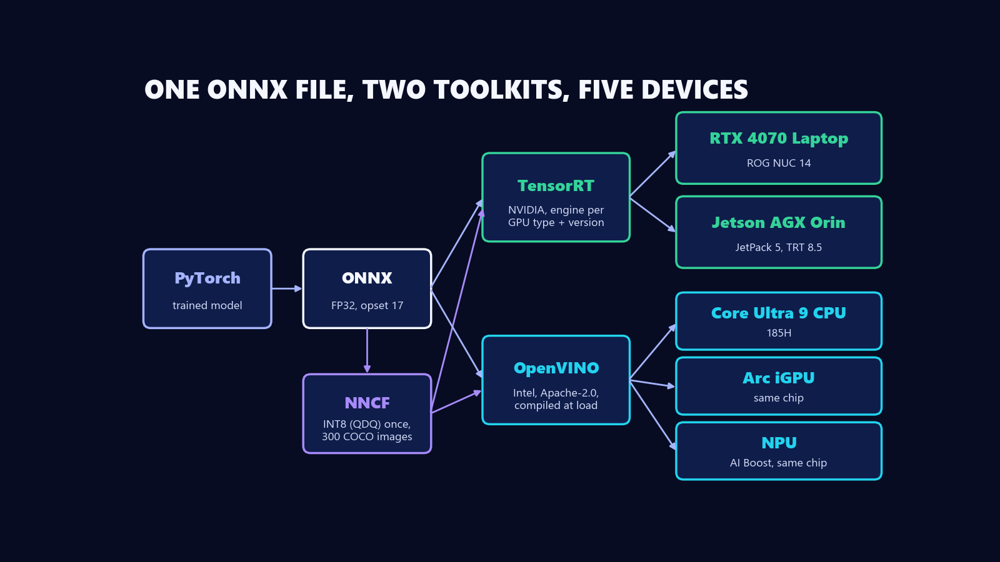
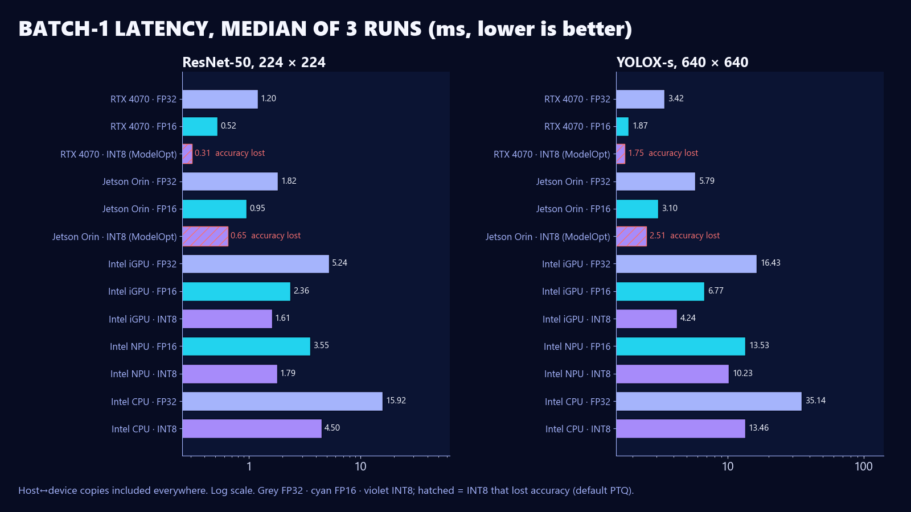
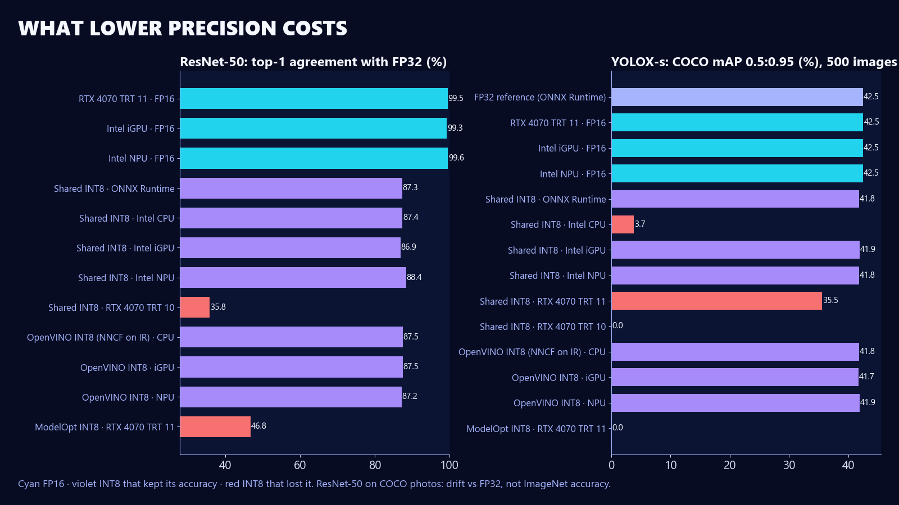

> **TLDR**: We ran ResNet-50 and YOLOX-s through TensorRT on an RTX 4070 Laptop GPU and a Jetson AGX Orin, and through OpenVINO on the CPU, iGPU and NPU of an Intel Core Ultra 9 185H. In FP16 the RTX 4070 is fastest (0.52 ms for ResNet-50, 1.87 ms for YOLOX-s, copies included); the Intel iGPU with INT8 reaches 1.61 ms and 4.24 ms on the same chip as the CPU. FP16 cost no accuracy anywhere. INT8 is where it got interesting: one INT8 ONNX file "for both toolkits" kept its accuracy only on the Intel iGPU and NPU, and with default settings none of our TensorRT INT8 builds kept it. Measure accuracy on the target, every time.

Hey there, in May I wrote about ONNX, the common format that lets you train in one framework and run anywhere [10], and in June about what happened to edge AI hardware, from the Neural Compute Stick to Hailo-8 [10]. This article is the next step: you have an ONNX file, now you need it to run fast on the machine in the cell. On NVIDIA hardware that usually means TensorRT, on Intel hardware OpenVINO.

In my own work, TensorRT is the one that went into projects: crack detection, and object detection in logistics, both on Jetson devices. OpenVINO I have only used at home so far, for testing, learning and evaluating it. So this benchmark was also a chance to give the Intel side a fair run on the same model.

Most comparisons you will find put TensorRT on a big GPU against OpenVINO on a laptop CPU, which tells you more about the hardware than about the toolkits. Our test box is different: an ASUS ROG NUC 14 with an RTX 4070 Laptop GPU **and** an Intel Core Ultra processor with its own integrated Arc GPU and an NPU [6], plus a Jetson AGX Orin. So in this article three things are covered: first, what an inference engine does and how the two toolkits differ; second, how to run the same model through both, STEP by STEP; and third, what we measured on five devices, including how much accuracy INT8 costs.

## What does an inference engine do?

A training framework like PyTorch is built to change a model. Once the model is trained, you want the opposite: freeze it and run it as fast as the device allows. An inference engine takes the trained graph (here as ONNX) and turns it into a program for one specific device: it merges layers that can run as one, picks the fastest implementation of each operation for that hardware, and can lower the numeric precision from 32-bit floats to 16-bit floats or 8-bit integers [5][8].

Two consequences matter in practice:

* **The result is device-specific.** By default, a TensorRT engine only runs with the TensorRT version that built it and on the type of device it was built on [1]. You ship the ONNX file and build the engine on (or for) the target.
* **Lower precision changes the numbers.** INT8 needs a calibration step with real images [4], and the result can drift from the FP32 model. You measure it, you do not assume it: that is what our accuracy check below does.

## TensorRT and OpenVINO side by side

| | TensorRT | OpenVINO |
| --- | --- | --- |
| Made by | NVIDIA | Intel |
| Runs on | NVIDIA GPUs (desktop, laptop, data centre, Jetson) | Intel CPUs (and ARM CPUs), Intel integrated and discrete GPUs, Intel NPUs [2] |
| Model input | ONNX (plus framework integrations) | PyTorch, TensorFlow, ONNX, Keras, PaddlePaddle, JAX, TensorFlow Lite [2] |
| Output | a serialized engine for one GPU type and TensorRT version [1] | a model compiled per device at load time (CPU, GPU, NPU) |
| INT8 | a pre-quantized (QDQ) ONNX file, e.g. from NVIDIA ModelOpt [12] | NNCF post-training quantization, about 300 calibration samples [4] |
| Licence | NVIDIA Software License Agreement: free to use, not open source [5] | Apache-2.0 [2]; NNCF Apache-2.0 [4] |
| On our machines | RTX 4070: TensorRT 11.4 (and 10.16 for comparison); Jetson AGX Orin: TensorRT 8.5.2 in JetPack 5.1.2 [7] | Core Ultra 9 185H CPU, Arc iGPU, NPU: OpenVINO 2026.4.1 |

Three details from the table are easy to miss:

* **Engine portability.** TensorRT can build engines that run on all Ampere-and-newer GPUs, or on later TensorRT versions, but NVIDIA warns that such engines can be slower than one built for the exact runtime [1]. On a Jetson running JetPack 5 you are on TensorRT 8.5.2 [7], so an engine built on a desktop with TensorRT 10 or 11 will not load there.
* **TensorRT 11 changed the precision flags.** In the TensorRT 11.4 container, `trtexec --fp16` is an unknown option, and the help text says strongly typed networks are "now enabled by default" [11]. The precision now comes from the ONNX file itself: for FP16 you convert the model to FP16 first. The same `--fp16` and `--int8` flags still work on the Jetson's TensorRT 8.5, so your build scripts differ per machine.
* **The NPU.** Intel's Core Ultra chips include an NPU, a low-power accelerator for neural networks. OpenVINO 2026.0 moved the NPU compiler into its NPU plug-in, so the compiler ships with OpenVINO instead of depending on OEM driver updates [3]. In practice, Intel's OpenVINO Docker image brought the GPU and NPU user-space drivers with it: we ran all three Intel devices without installing anything on the host [11].



## Our test setup

* **ROG NUC 14:** Intel Core Ultra 9 185H (CPU, Arc iGPU, NPU) and an RTX 4070 Laptop GPU, 8 GB [6], Ubuntu 24.04, NVIDIA driver 595.99. TensorRT 11.4 and 10.16 from NVIDIA's NGC containers, OpenVINO 2026.4.1 from Intel's container.
* **Jetson AGX Orin 64 GB**, JetPack 5.1.2 (TensorRT 8.5.2, CUDA 11.4) [7], power mode MAXN.
* **Models:** ResNet-50 (classification, 224 × 224, torchvision weights [15]) and YOLOX-s (detection, 640 × 640, official weights [13]), exported once to ONNX and copied unchanged to every machine (sha256 checked).
* **Precisions:** FP32, FP16 and INT8. INT8 two ways: one shared file made with NNCF from 300 COCO images [14], and each toolkit's own path (NNCF on the OpenVINO model, NVIDIA ModelOpt for TensorRT [12]).
* **Protocol:** batch 1, 30 s per run after warm-up, median of 3 runs; median and p99 latency. Host↔device copies are included everywhere (TensorRT 11 skips them by default, so we added `--includeDataTransfers`).
* **Accuracy:** ResNet-50 top-1 agreement with the FP32 model on 1,000 COCO images (drift, not ImageNet accuracy), YOLOX-s COCO mAP on 500 other images. Calibration images are never used for the accuracy check.

Every command, log and the sha256 of each file are in the benchmark folder [11].

## STEP1: export the model to ONNX

One file per model, static batch 1, opset 17. For YOLOX we keep the raw head and decode the boxes in NumPy, so the decoding stays out of the quantized graph:

```python
import torch, torchvision

m = torchvision.models.resnet50(weights="IMAGENET1K_V2").eval()
torch.onnx.export(m, torch.randn(1, 3, 224, 224), "models/resnet50.onnx",
                  opset_version=17, input_names=["images"], output_names=["logits"], dynamo=False)
# YOLOX-s: same call on the official model (repo YOLOX, weights yolox_s.pth),
# with model.head.decode_in_inference = False, input 1x3x640x640
```

```text
models/resnet50.onnx 1db0bf56c64d…718c
models/yolox_s.onnx  8247fe802367…6f10
```

## STEP2: quantize once with NNCF

NNCF's post-training quantization needs a model and about 300 representative images [4]. On ONNX it writes a standard ONNX file with QuantizeLinear/DequantizeLinear (QDQ) pairs, which both toolkits can read:

```python
import nncf, onnx

model = onnx.load("models/resnet50.onnx")
data = nncf.Dataset(calib_paths, lambda p: {"images": resnet_input(p)})   # 300 COCO images, same pre-processing as inference
q = nncf.quantize(model, data, subset_size=300)
onnx.save(q, "models/resnet50_int8.onnx")
```

```text
resnet50: quantized in 34 s
yolox_s: quantized in 39 s
```

That took about half a minute per model on the Core Ultra CPU. Keep that file in mind: it is the "one INT8 file for both toolkits" we test below.

## STEP3: TensorRT on the RTX 4070 and the Jetson

On the RTX 4070 (TensorRT 11.4), the precision comes from the file, so FP16 starts with a converted copy:

```python
from onnxconverter_common import float16
onnx.save(float16.convert_float_to_float16(onnx.load("models/yolox_s.onnx"), keep_io_types=True),
          "models/yolox_s_fp16.onnx")
```

```bash
docker run --rm --gpus all -v $PWD:/work -w /work nvcr.io/nvidia/tensorrt:26.10-py3 \
  trtexec --onnx=models/yolox_s_fp16.onnx --saveEngine=engines/yolox_s-fp16.plan --skipInference
docker run --rm --gpus all -v $PWD:/work -w /work nvcr.io/nvidia/tensorrt:26.10-py3 \
  trtexec --loadEngine=engines/yolox_s-fp16.plan --useCudaGraph --warmUp=2000 --duration=30 \
          --percentile=99 --includeDataTransfers
```

What the flags do:

```text
--skipInference          build and save the engine, don't benchmark yet
--useCudaGraph           launch the whole network as one CUDA graph (less CPU overhead per frame)
--warmUp=2000            2 s warm-up (GPU clocks up, caches filled) before measuring
--duration=30            measure for 30 s
--percentile=99          report p99 latency next to the median
--includeDataTransfers   count the copies to and from the GPU (TensorRT 11 leaves them out by default)
```

On the Jetson (TensorRT 8.5.2), the old weakly typed flags still apply and the copies are counted by default:

```bash
/usr/src/tensorrt/bin/trtexec --onnx=models/yolox_s.onnx --fp16 --saveEngine=engines/yolox_s-fp16.plan --buildOnly
```

Build times were 17 s (ResNet-50) and 59 s (YOLOX-s) in FP16 on the RTX 4070, and 64 s and 10.4 minutes on the Jetson. Plan for that if you build on the device at first boot.

## STEP4: OpenVINO on the CPU, the iGPU and the NPU

Intel's image already contains the GPU and NPU drivers; you only pass the devices into the container:

```bash
docker run --rm -it --device /dev/dri --device /dev/accel \
  --group-add $(getent group render | cut -d: -f3) -v $PWD:/work -w /work \
  openvino/ubuntu24_dev:2026.4.1 bash
benchmark_app -m models/yolox_s.onnx -d GPU -hint latency -t 30 -infer_precision f16
```

```text
-d CPU|GPU|NPU           the device; GPU is the Arc iGPU here, NPU the "AI Boost" NPU
-hint latency            optimise for one request at a time (batch-1 latency); "throughput" runs several in parallel
-t 30                    run for 30 s
-infer_precision f16     run in FP16 (f32 for full precision); the NPU uses FP16 by default
-latency_percentile 99   report p99 instead of the median (one extra run per case)
```

OpenVINO compiles at load time, and fast: 0.1 s on the CPU, 1.5 to 2.4 s on the iGPU and 0.6 to 0.9 s on the NPU in our runs [11]. No separate build step to manage per device.

## Results: speed

| Batch-1 latency, median (ms) | FP32 | FP16 | INT8 |
| --- | --- | --- | --- |
| **ResNet-50** · RTX 4070, TensorRT 11.4 | 1.20 | **0.52** | 0.31 ⚠ |
| Jetson Orin, TensorRT 8.5.2 | 1.82 | 0.95 | 0.65 ⚠ |
| Intel iGPU, OpenVINO | 5.24 | 2.36 | 1.61 |
| Intel NPU, OpenVINO | — | 3.55 | 1.79 |
| Intel CPU, OpenVINO | 15.9 | — | 4.50 |
| **YOLOX-s** · RTX 4070, TensorRT 11.4 | 3.42 | **1.87** | 1.75 ⚠ |
| Jetson Orin, TensorRT 8.5.2 | 5.79 | 3.10 | 2.51 ⚠ |
| Intel iGPU, OpenVINO | 16.4 | 6.77 | 4.24 |
| Intel NPU, OpenVINO | — | 13.5 | 10.2 |
| Intel CPU, OpenVINO | 35.1 | — | 13.5 |

Copies included; INT8 = each toolkit's own INT8 path; ⚠ = fast, but that INT8 build lost its accuracy (next section). p99 latencies, throughput and build times are in `results.csv` [11].



What stands out:

* **FP16 is the easy win on NVIDIA.** It halves the latency on both GPUs with no accuracy cost (next section). Note that TensorRT's FP32 already uses TF32 on this GPU unless you pass `--noTF32`.
* **The copies matter on a discrete GPU.** For YOLOX-s, the RTX 4070 computes FP16 in 0.95 ms but needs 1.87 ms with the input and output copies: a 640 × 640 float input is 4.9 MB over PCIe [11]. Benchmarks without copies flatter discrete GPUs. On the Jetson the memory is shared.
* **The Intel iGPU is the strongest Intel device here,** and with INT8 it is only 2 to 3 times slower than the RTX 4070 in FP16, on the same chip as the CPU. In throughput mode it reached 1,150 images/s on ResNet-50 [11].
* **The NPU is slower than the iGPU** on both models, but it is a separate low-power unit that leaves the CPU and iGPU free. We could not measure power on the Intel side, so the efficiency argument stays a claim to test, not a result.
* **INT8 on the CPU is worth it:** 3.5× faster on ResNet-50 and 2.6× on YOLOX-s, once the accuracy holds (it did with OpenVINO's own INT8 path).

The RTX 4070 drew a median of 105 W while benchmarking [11].

## Results: what INT8 costs

| | ResNet-50 top-1 agreement with FP32 | YOLOX-s mAP (FP32: 42.5) |
| --- | --- | --- |
| FP16, every device | 99.3–99.6 % | 42.5 |
| **Shared NNCF INT8 file** · ONNX Runtime (reference) | 87.3 % | 41.8 |
| Intel iGPU / NPU | 86.9 / 88.4 % | 41.9 / 41.8 |
| Intel CPU | 87.4 % | **3.7** |
| RTX 4070, TensorRT 11.4 | build fails | 35.5 |
| RTX 4070, TensorRT 10.16 | **35.8 %** | **0.0** |
| Jetson, TensorRT 8.5.2 | builds (accuracy not measured) | build fails |
| **OpenVINO's own INT8** (NNCF on the OpenVINO model) · CPU / iGPU / NPU | 87.5 / 87.5 / 87.2 % | 41.8 / 41.7 / 41.9 |
| **NVIDIA ModelOpt INT8, default settings** · RTX 4070 | 46.8 % | 0.0 (no detections) |



Three things to read from this table.

First, **what "87 %" means.** ResNet-50 knows 1,000 ImageNet classes and we show it COCO street and kitchen scenes, so it is rarely sure of itself: only 113 of the 1,000 images get a top class above 50 % confidence. On those 113, INT8 agrees with FP32 on 99.1 % [11]. The 13 % that change are mostly coin flips between two classes the model already doubted. For YOLOX-s, INT8 costs 0.6 to 0.8 mAP points where it works, which is what you would hope for.

Second, **one INT8 file is not yet portable.** The same NNCF file, which ONNX Runtime runs as expected (our reference), kept its accuracy on the Intel iGPU and NPU, collapsed on the Intel CPU for YOLOX-s, and failed on every TensorRT version we tried: two builds stopped with internal errors, and the engines that did build lost from 6 mAP points (YOLOX-s on TensorRT 11.4) to nearly everything. The file is valid ONNX; the toolkits simply execute its quantization pattern differently. OpenVINO's CPU result was fixed by quantizing the OpenVINO model instead of the ONNX file (same tool, same 300 images): 41.8 mAP.

Third, **TensorRT INT8 needs its own homework.** NVIDIA's ModelOpt is the tool built for TensorRT, and its INT8 engines were the fastest numbers in this article (0.31 ms for ResNet-50). But with its default settings and our 300 calibration images, the quantized file already lost the accuracy before TensorRT touched it: ONNX Runtime gives the same 47 % agreement and zero detections on it [11]. For YOLOX-s the detection scores collapse, a typical sign that the head should stay in higher precision. Tuning that (excluding layers, other calibration methods) is a project of its own and outside this benchmark. The lesson stands either way: a fast INT8 number means nothing until you have checked the accuracy on the target.

Have I seen accuracy loss after lowering the precision in a real project? Yes, every time. It was always a trade-off between speed and accuracy, and someone had to make the call for that project. A table like the one above is what that decision should be based on: per model, per device, measured.

## Which one should you pick?

You might be asking "which toolkit should I select for my application?". In most cases the hardware answers first:

1- **The target has an NVIDIA GPU** (a GPU PC or a Jetson) → TensorRT. Build the engine on the target, or with the same TensorRT version and GPU type [1]. Start with FP16: it halved the latency in our runs and cost nothing in accuracy. Treat INT8 as a separate step with its own accuracy check, and expect to tune the quantization.
2- **The target is an Intel industrial PC or laptop** → OpenVINO, and try the iGPU and the NPU before buying a GPU. On our Core Ultra, the iGPU with INT8 ran YOLOX-s at 4.24 ms against 35.1 ms on the CPU in FP32, and the NPU at 10.2 ms.
3- **You do not know the target yet, or it changes** → keep the FP32 ONNX file as the deliverable, not an INT8 one. Quantize per toolkit (NNCF on the OpenVINO model, ModelOpt for TensorRT) and validate per device. In our runs the shared INT8 file only held on the Intel iGPU and NPU.

| | TensorRT | OpenVINO |
| --- | --- | --- |
| PROS | fastest numbers here; FP16 halves latency at no accuracy cost; Jetson and data-centre GPUs with one toolkit | runs on hardware you already have (CPU, iGPU, NPU); Apache-2.0; fast compile at load time; drivers came with the Docker image |
| CONS | engine per GPU type and version; flags changed between 8.5, 10 and 11; INT8 needs per-model tuning; proprietary licence | slower than a discrete GPU; the same INT8 file behaved differently on CPU and iGPU; NPU power savings we could not measure here |

A word on my own bias here. My deployments ran on NVIDIA GPU machines and Jetsons; I have little hands-on experience with Intel accelerators, and none with the NPU. What decided our choices was speed first. The licence mattered less, because we worked as a research and technology organisation (RTO), not as a product vendor. If you ship a product, look at the licence row in the table above more carefully than we had to.

So for the Intel side, take this as advice from the numbers, not from the field: if the industrial PC in the cell already has a Core Ultra, try its iGPU before adding a GPU. In our runs it ran YOLOX-s in INT8 at 4.24 ms, well inside a typical camera frame time, with no extra hardware, power supply or cooling. Keep the NPU in mind for the case where the CPU and iGPU are busy with other work, and measure its power yourself before you count on it.

## Key Take-Aways

After reading this article you should be able to answer for yourself, and why not explain to others, the following:

* What an inference engine does with an ONNX model, and why the result is tied to a device.
* Where TensorRT and OpenVINO run, how their licences differ, and why TensorRT 11 no longer takes `--fp16`.
* How to run one model through both toolkits, and why a fair benchmark counts the copies to and from the GPU.
* The speed ranking we measured: RTX 4070 FP16 first (0.52 / 1.87 ms), then the Jetson, then the Intel iGPU with INT8 (1.61 / 4.24 ms), the NPU and the CPU.
* What INT8 costs: about 0.7 mAP when it works, everything when it doesn't. One INT8 file is not portable yet; quantize per toolkit and check accuracy on the target.

As always to end this article, here is the "***Quote of the Article***":

> **"We should forget about small efficiencies, say about 97% of the time: premature optimization is the root of all evil."** — Donald E. Knuth [9]

The same paper goes on: "Yet we should not pass up our opportunities in that critical 3 %" [9]. Inference on the device in your cell is usually that 3 %: measure it, then optimize it, then measure the accuracy again.

Cheers

Merwansky

---

*This article was drafted with AI assistance from the documentation listed below and the author's benchmark runs, and reviewed and completed by the author.*

## Sources

1. NVIDIA, *TensorRT: Engine Compatibility* (hardware and version compatibility). https://docs.nvidia.com/deeplearning/tensorrt/latest/inference-library/engine-compatibility.html
2. Intel, *OpenVINO* repository README (Apache-2.0; supported hardware and model formats), GitHub. https://github.com/openvinotoolkit/openvino
3. M. Larabel, *Intel Releases OpenVINO 2026 With Improved NPU Handling, Expanded LLM Support*, Phoronix, 2026-02-23. https://www.phoronix.com/news/Intel-OpenVINO-2026.0-Released
4. Intel, *Neural Network Compression Framework (NNCF)* repository README (Apache-2.0; post-training quantization for ONNX and OpenVINO). https://github.com/openvinotoolkit/nncf
5. NVIDIA, *TensorRT documentation* ("an SDK for optimizing deep learning inference on NVIDIA GPUs") and the *NVIDIA Software License Agreement* named in the TensorRT container's governing terms. https://docs.nvidia.com/tensorrt/ · https://www.nvidia.com/en-us/agreements/enterprise-software/nvidia-software-license-agreement/
6. ASUS, *ROG NUC (NUC14SRK) specifications*. https://rog.asus.com/desktops/mini-pc/rog-nuc/spec
7. NVIDIA, *JetPack SDK 5.1.2* (TensorRT 8.5.2, CUDA 11.4.19, cuDNN 8.6.0, DLA 3.12.1). https://developer.nvidia.com/embedded/jetpack-sdk-512
8. Intel, *Benchmark Tool* (OpenVINO 2026 documentation) and the `benchmark_app -h` help of OpenVINO 2026.4.1. https://docs.openvino.ai/2026/get-started/learn-openvino/openvino-samples/benchmark-tool.html
9. D. E. Knuth, *Structured Programming with go to Statements*, Computing Surveys, 6(4), December 1974, p. 268. https://www.gwern.net/doc/cs/algorithm/1974-knuth.pdf
10. M. Birem, *What is ONNX? The Universal Language of AI Models*, Medium, 2026-05-17, https://medium.com/@just-merwan/what-is-onnx-the-universal-language-of-ai-models-196c959cc142 · *From Neural Compute Stick to Hailo-8: What Actually Happened to Edge AI Hardware*, Medium, 2026-06-20, https://medium.com/@just-merwan/from-neural-compute-stick-to-hailo-8-what-actually-happened-to-edge-ai-hardware-e5434b0b8b63
11. M. Birem, benchmark runs for this article, 2026-11-01: TensorRT 11.4.0 and 10.16.1 (NGC containers) on the RTX 4070 Laptop, TensorRT 8.5.2 on the Jetson AGX Orin, OpenVINO 2026.4.1 on the Core Ultra 9 185H; scripts, raw logs, `results.csv`, accuracy files and sha256 of every model. Available upon request.
12. NVIDIA, *TensorRT Model Optimizer (ModelOpt)*, GitHub, Apache-2.0 (version 0.47.0 used). https://github.com/NVIDIA/TensorRT-Model-Optimizer
13. Z. Ge, S. Liu, F. Wang, Z. Li, J. Sun, *YOLOX: Exceeding YOLO Series in 2021*, arXiv:2107.08430, 2021; code and weights: https://github.com/Megvii-BaseDetection/YOLOX (Apache-2.0)
14. T.-Y. Lin et al., *Microsoft COCO: Common Objects in Context*, ECCV 2014; val2017 images and annotations (annotations CC BY 4.0). https://cocodataset.org
15. PyTorch, *torchvision ResNet-50* model weights (IMAGENET1K_V2), BSD-3. https://docs.pytorch.org/vision/stable/models/generated/torchvision.models.resnet50.html

_Accessed 2026-10-31 and 2026-11-01._
